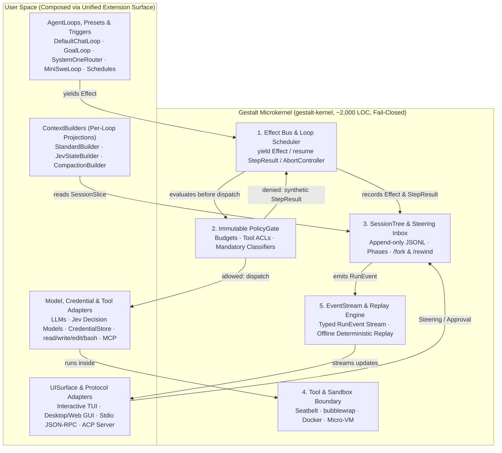
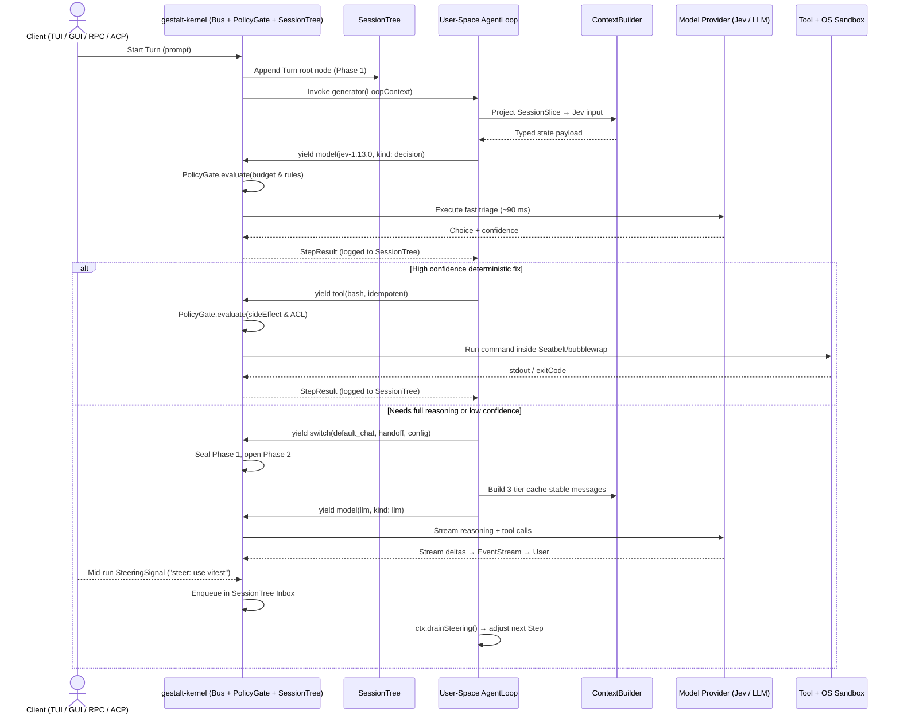
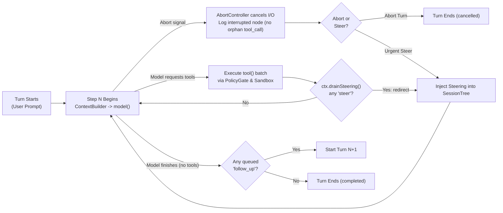
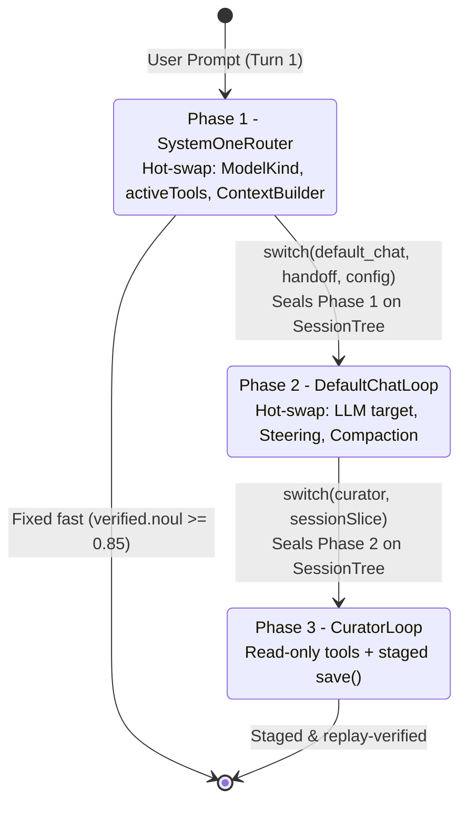

# Gestalt: A Microkernel Agent Harness for Dynamic Semantics

> **Architectural Verdict:** **Gestalt** is an open-source, terminal-native agent harness built on a ~2,000-line invariant microkernel (`gestalt-kernel`) paired with a batteries-included standard user-space harness (`gestalt-std` + `gestalt-cli`). Instead of hard-coding a generative `context → LLM → tool → observation` loop into the core—or dissolving the entire runtime into an "everything-is-a-plugin" dependency graph—Gestalt isolates five non-negotiable invariants in the kernel (`SessionTree`, typed `Effect` bus, fail-closed `PolicyGate`, `Sandbox` boundary, and `EventStream`) while shipping full out-of-the-box agentic capabilities (**chat, tool calling, reasoning streams, mid-run steering, context compaction, TUI/RPC, and ACP**) and a single unified **`Extension`** surface for all user-space customization.

---

## 1. What Gestalt Is

Gestalt is both a **minimal programmable agent runtime** and a **working, hackable agent harness** inspired by the Unix-like composability of [Pi](https://github.com/earendil-works/pi).

Most open-source agent projects fall into one of two traps:
1. **Hard-coded LLM loops:** Harnesses such as [Pi](https://github.com/earendil-works/pi), [mini-swe-agent](https://ai.miraheze.org/wiki/Mini-SWE-agent), [Goose](https://goose-docs.ai/docs/goose-architecture/), [Hermes](https://hermes-agent.nousresearch.com/docs/developer-guide/architecture), and [easy-agent](https://github.com/ConardLi/easy-agent) ship useful defaults, but their core assumption is that a generative LLM owns every iteration of the loop. When non-generative models arrive—such as TypeSafe AI's fast typed decision model [Jev](https://docs.typesafe.ai/concepts/system-one)—developers are forced to bolt them on as optional MCP tools ([jev-mcp](https://github.com/jkudish/jev-mcp)) or cold-starting CLI hooks ([jevwire](https://github.com/Brainwires/jevwire)).
2. **Unbounded plugin graphs:** [DeepSeek Harness](https://github.com/deepseek-ai/deepseek-harness/blob/master/docs/architecture.md) eliminates the fixed core via [Cordis](https://arxiv.org/abs/2608.25512) spatiotemporal composability, making even `ctx.agentLoop` a replaceable plugin. However, as its [architecture and security review](https://contextosai.com/blog/deepseek-harness-architecture-security-review) documents, removing all kernel invariants externalizes the root of trust (making security and sandboxing plugins themselves) and relocates system complexity into a combinatorial graph of profiles, bundle orders, patch overlays, and event waterfalls.

**Gestalt's thesis (The Linux Kernel Philosophy):** Like the Linux repository, Gestalt separates its core into:
1. **Bare-bones kernel & driver primitives (`gestalt-kernel` + `gestalt-runtime`):** The invariant microkernel owns *only* core mechanism, scheduling, state tree, policy gating, and syscall/effect semantics (`SessionTree`, `Effect` bus, `PolicyGate`, `Sandbox` boundary, `EventStream`), while `gestalt-runtime` supplies the bare-minimum host driver primitives (effect I/O driver, IPC extension bus, OS sandbox drivers, blob/credential store, provider bus) needed to run on an actual OS.
2. **Built-in default userland (`gestalt-std` + `gestalt-cli`):** Shipped in the same repo so Gestalt boots out of the box as an immediately usable product (default loops, tools, provider adapters, and CLI/TUI/RPC/ACP surfaces)—registered strictly through the public `Extension` and driver contracts with zero kernel privileges.
3. **Self-improvement in user space:** Because `gestalt-std` gives the booted agent working tools and loops out of the box, the agent can improve within itself when prompted—authoring new extensions, custom agent loops, skills, tools, and UI surfaces into user space and hot-loading them via `/reload` without modifying or recompiling the kernel or runtime.

---

## 2. Glossary & Term Descriptions

Every core term in Gestalt is named directly for what it does in an agent harness:

| Term | Layer | Description |
| :--- | :--- | :--- |
| **`SessionTree`** | Kernel | The canonical, append-only, content-addressed JSONL tree of a session. Every node records `{ id, parentId, phaseId, kind, payload, digest }`. User messages, model outputs, tool results, steering signals, and reasoning traces live here; chat `messages[]` arrays are derived views, never canonical state. |
| **`Turn`** | Harness / Kernel | One complete user-facing interaction cycle (from a user prompt or [ACP](https://agentclientprotocol.com/protocol/v1/prompt-turn) `session/prompt` until the agent finishes or is aborted). A Turn can span multiple Steps and multiple Phases. |
| **`Step`** | Harness / Kernel | One atomic model call plus its resulting tool batch (or a single standalone action). Steering and budget checks align cleanly at Step boundaries. |
| **`Phase`** | Kernel | A bounded execution mode inside a session governed by one active `AgentLoop`, `ContextBuilder`, and `LoopConfig` (e.g., `triage` phase → `general` phase). Switching modes requires an explicit `switch` effect that seals the current Phase and logs a typed handoff. |
| **`Effect`** | Kernel | A typed request yielded by an `AgentLoop` to the kernel (`model`, `tool`, `save`, `spawn`, `switch`, `pause`). Loops never perform I/O or call models directly; they yield Effects and receive `StepResult` values. |
| **`StepResult`** | Kernel | The kernel-recorded outcome of executing an `Effect` (e.g., model response, tool stdout/stderr, policy denial, or user approval). Logged atomically on the `SessionTree` for deterministic offline replay. |
| **`PolicyGate`** | Kernel | The immutable, fail-closed security and budget guard inside the kernel. Evaluates every `model`, `tool`, `save`, and `spawn` Effect *before* execution, enforcing token/step/cost limits, tool allowlists, and mandatory classifiers (including System One checks). |
| **`Tool`** | Boundary | A typed action adapter (e.g., `read`, `write`, `edit`, `bash`, MCP tool bridge, GUI input) tagged with an explicit `sideEffect` class (`read`, `idempotent`, `irreversible`) and bound to a `Sandbox`. |
| **`Sandbox`** | Boundary | The OS-level or VM-level execution environment (e.g., macOS Seatbelt, Linux `bubblewrap`, Docker, or micro-VM) attached to a session or Phase to enforce filesystem, process, and network isolation. |
| **`AgentLoop`** | User Space | An ordinary async generator `(ctx: LoopContext) => AsyncGenerator<Effect, Result, StepResult>` that defines an agent's control flow (e.g., default chat loop, `mini-swe` loop, `GoalLoop`, Planner/Executor/Critic, or System One router). |
| **`ContextBuilder`** | User Space | A pure function `(sessionHead, memoryFiles, modelCaps) => ModelInput` invoked per Step by an `AgentLoop` to project the `SessionTree` and artifacts into the exact payload a target model expects (e.g., cache-stable Anthropic messages, Jev state JSON, or compacted summaries). |
| **`ModelKind`** | User Space | Identifies the paradigm of a model invoked via a `model` Effect: `llm` (generative text/tool models), `decision` (fast typed System One models like Jev), `embedding`, `world_model`, or `computer_use`. |
| **`Steering`** | Kernel / Harness | Mid-run redirection and interruption. User or supervisor inputs enter a kernel-managed `Inbox` on the `SessionTree` as `steer` (apply at next Step), `follow_up` (queue for next Turn), or `abort` (cancel in-flight Step cleanly). |
| **`pause`** | Kernel | An Effect (`approval`, `input`, `checkpoint`) that suspends execution and yields control to the client (TUI, GUI, RPC, or ACP) until a human or external system responds. |
| **`spawn`** | Kernel | An Effect that launches an isolated, non-nesting subagent run with its own `BudgetCap`, `depthLimit`, and `SessionTree` branch—preventing runaway recursion and context pollution. |
| **`save`** | Kernel | A versioned mutation to persistent harness files (memory files, `SKILL.md` procedures, context builders) with `stage` (sandboxed diff + replay check) and `promote` (PolicyGate-approved activation) modes. |
| **`EventStream`** | Kernel | A protocol-neutral stream of typed `RunEvent` notifications emitted as the `SessionTree` advances, consumed identically by the TUI, GUI, headless JSON-RPC, and [ACP](https://agentclientprotocol.com/protocol/v1/overview) adapters. |
| **`Trigger`** | User Space | An event or schedule source (interval `/loop`, cloud `/schedule`, webhook, or file watcher) that dispatches new `Turn`s into the kernel for time-based and proactive loops. |
| **`Extension`** | User Space | The single unified packaging and integration primitive (`defineExtension()`) through which developers register loops, presets, triggers, context builders, models, credentials, tools, sandboxes, policy rules, commands, and UI components—merging "extensions" and "plugins" into one surface. |
| **`UISurface`** | User Space | The UI sub-contract inside an `Extension` (`renderers`, `panels`, `dialogs`, `actions`) that binds `EventStream` and `pause` events to TUI or GUI components without coupling UI code to the kernel. |

---

## 3. Comparative Audit: What Gestalt Keeps vs. Rejects

Gestalt's design is grounded in primary-source audits of six reference harnesses and protocols:

| Reference Project | Core Mechanism | Key Strength | Limitation / Failure Mode | Gestalt Decision |
| :--- | :--- | :--- | :--- | :--- |
| **[Pi](https://github.com/earendil-works/pi)** (`earendil-works/pi`) | `pi-agent-core` LLM loop, JSONL tree sessions ([Run Modes](https://www.developersdigest.tech/blog/pi-hands-on-run-modes-session-trees-guide)), stdio RPC, `pi-tui`. | Hackable small core, tree-structured JSONL history, clean CLI/TUI/RPC modes. | LLM-centric core loop; no built-in kernel permission gate ([Pi README](https://github.com/earendil-works/pi)). | **Keep:** JSONL tree, stdio RPC, TUI ergonomics.<br>**Change:** Remove fixed LLM loop from core; add fail-closed `PolicyGate`. |
| **[mini-swe-agent](https://ai.miraheze.org/wiki/Mini-SWE-agent)** | ~100-line Python loop with stateless bash subprocesses (&gt;74% SWE-bench Verified). | Proves high capability comes from clean loops, not framework bulk ([Harness Engineering](https://arxiv.org/html/2609.00006v1)). | Flat message list state; no structured steering or policy boundary. | **Keep:** 30–100 line readable loop ideal.<br>**Change:** Express loops as user-space `AgentLoop`s over a `SessionTree`. |
| **[Goose](https://goose-docs.ai/docs/goose-architecture/)** (`aaif-goose/goose`) | Rust/`tokio` loop, everything-as-MCP (`rmcp`), bidirectional ACP, SQLite `--fork`, Boa JS [`Code Mode`](https://goose-docs.ai/blog/2025/12/15/code-mode-mcp/). | Bidirectional ACP, isolated non-nesting subagents, collapsing MCP tool bloat via `Code Mode`. | Everything-is-MCP tax; [Adversary Mode](https://goose-docs.ai/docs/guides/security/adversary-mode/) fails open on error; subagents disabled in approval modes. | **Keep:** ACP, non-nesting `spawn`, `Code Mode` as an optional adapter.<br>**Reject:** Fail-open security &amp; mandatory MCP wrapping. |
| **[Hermes](https://hermes-agent.nousresearch.com/docs/developer-guide/architecture)** (`NousResearch/hermes-agent`) | Python `AIAgent` monolith, bounded [`MEMORY.md` / `USER.md`](https://hermes-agent.nousresearch.com/docs/user-guide/features/memory), progressive `SKILL.md`, [Curator](https://www.google.com/search?q=https://github.com/nousresearch/hermes-agent/blob/main/website/docs/user-guide/features/curator.md) + SHA-256 ledger, [GEPA](https://github.com/NousResearch/hermes-agent-self-evolution). | Cache-stable 3-tier prompt assembly, bounded memory artifacts, SHA-256 rollback ledger. | Monolithic core; frozen-snapshot blindness in long sessions; shell can bypass tool-level `write_approval`. | **Keep:** 3-tier cache-stable building, staged diffs, SHA-256 rollback.<br>**Reject:** Monolithic coupling &amp; soft tool-only write gates. |
| **[DeepSeek Harness](https://github.com/deepseek-ai/deepseek-harness/blob/master/docs/architecture.md)** &amp; **[Cordis](https://arxiv.org/abs/2608.25512)** | Everything-is-a-plugin over Cordis (`Context`, `Fiber`, `Service`, revertible `Effect`, event waterfalls). | Formal resource cleanup and hot-swapping of `ctx.agentLoop` and sandboxes. | Combinatorial config state space; externalized root of trust; in-process disposables cannot undo external side effects ([Security Review](https://contextosai.com/blog/deepseek-harness-architecture-security-review)). | **Keep:** Durable event log &amp; strict resource lifetimes.<br>**Reject:** Plugin-based security &amp; proxy DI containers. |
| **[Vercel AI SDK](https://www.runtype.com/explore/vercel-ai-sdk-backend)** &amp; **[easy-agent](https://github.com/ConardLi/easy-agent)** | `ToolLoopAgent` (`stopWhen`, `prepareStep`, `activeTools`, `needsApproval`), `@ai-sdk/code-mode` QuickJS; `eagent` Seatbelt/`bubblewrap` + JSON-RPC. | Owning the loop in plain TypeScript; per-step model/tool narrowing; native OS sandboxes. | Assumes each step is a generative text turn with tool calls. | **Keep:** Explicit per-step configuration &amp; OS sandboxing.<br>**Reject:** Generative-only step abstraction. |

---

## 4. Architecture & How Gestalt Works

Gestalt's kernel (`gestalt-kernel`, budgeted at &le;2,000 LOC) owns **mechanism and trust**. It knows nothing about prompts, markdown skills, chat roles, or LLM providers. Everything that defines *how* an agent thinks or interacts lives above the syscall line in user space.

### System Layers: Invariant Kernel vs. Dynamic User Space



### How It Works: End-to-End Execution Flow

When a user submits a task—or injects a mid-run steering signal—execution moves through a strict, observable cycle between user space and the kernel:



1. **Pure Projection Before Every Step:** An `AgentLoop` never reads raw global mutable state. It calls a `ContextBuilder` on its `LoopContext` to project the `SessionTree` into whatever input the next model expects—whether that is a cache-stable 3-tier chat prompt for an LLM or a compact JSON state object for [Jev](https://docs.typesafe.ai/concepts/system-one).
2. **Yielding Effects Instead of Direct I/O:** The `AgentLoop` yields a typed `Effect` (`model`, `tool`, `save`, `spawn`, `switch`, or `pause`) and suspends.
3. **Fail-Closed PolicyGate Inspection:** Before anything executes, the kernel's immutable `PolicyGate` checks token/step budgets, tool permissions, and mandatory guardrails (such as a System One safety classifier or regex filter—requested via a `RequiresVerification` deferral so the kernel itself remains pure/sans-I/O and logs the verifier's `StepResult` for replay). If the gate errors or denies the action, execution fails closed and returns a `denied` `StepResult` to the `AgentLoop`.
4. **Sandboxed Dispatch, Blob Spill & Atomic Logging:** Approved `tool` calls run inside the bound OS/VM `Sandbox` (with artifact directories mounted read-only). Transient streaming chunks (`message_delta`, `thought_delta`, `tool_output_delta`) stream immediately over `EventStream`, while only canonical `Effect`s and assembled `StepResult`s are appended atomically to the JSONL `SessionTree` (spilling payloads `> 32 KB` or multimodal assets to `.gestalt/blobs/<sha256>`).
5. **Cooperative Steering & Phase Switches:** Between yields, the `AgentLoop` drains mid-run `SteeringSignal`s from `ctx.drainSteering()`. Switching from one reasoning paradigm to another happens only via an explicit `switch` Effect that seals the current `Phase` and logs a typed handoff.

### How Gestalt Approaches Steps, Turns & Steering

Most harnesses blur **Turns** and **Steps**, which causes two bugs under mid-run steering: either steering is ignored until the entire multi-step Turn finishes, or an abrupt cancel leaves an unpaired `tool_call` in the message history that crashes the next API request. Gestalt separates the two cleanly:

- **Turn:** One user-facing request/response cycle (e.g., one user prompt or one [ACP](https://agentclientprotocol.com/protocol/v1/prompt-turn) `session/prompt`). A Turn owns a `TurnId` on the `SessionTree` and may take 1 to *N* Steps.
- **Step:** One atomic unit of progress inside a Turn—typically one `model` call plus the `tool` batch it requested (or one `decision` model + deterministic `tool`).



Gestalt handles three distinct steering timing modes:
1. **Between Steps (Intra-Turn `steer`):** If a user sends a `steer` message while tools are executing, it enters the `SessionTree` `Inbox` (recorded immediately as a `steering` node for crash-safety and deterministic replay). Once the current tool batch finishes (so every `tool_call` has its matching `tool_result`), `AgentLoop` calls `ctx.drain_steering()` and feeds the drained signal into the *next* Step's `ContextBuilder`—redirecting the current Turn without losing work already completed. Un-drained `Steer` signals carry across `Effect::Switch` and auto-promote to `FollowUp` if the Turn ends before draining.
2. **Mid-Step (Preemptive `abort` or Urgent `steer`):** If the user hits `/stop`, `Ctrl+C`, or sends `session/cancel` while a model stream or shell command is in flight, the kernel triggers the Step's `AbortController`. In-flight streaming deltas are discarded or marked `interrupted` on the `SessionTree`, and if a `tool_call` was already emitted without a result, the kernel synthesizes a `{ status: "aborted" }` `StepResult` so the `SessionTree` never contains broken tool-call pairs.
3. **Between Turns (Queued `follow_up`):** New prompts sent while an agent is working can be tagged `follow_up`; they wait in the `Inbox` until the active Turn completes cleanly, then launch a fresh Turn.

### Core Kernel Interfaces

```rust
use serde::{Deserialize, Serialize};
use serde_json::Value;

#[derive(Debug, Clone, Copy, PartialEq, Eq, Serialize, Deserialize)]
#[serde(rename_all = "snake_case")]
pub enum ModelKind {
    Llm,
    Decision,
    Embedding,
    WorldModel,
    ComputerUse,
}

#[derive(Debug, Clone, Copy, PartialEq, Eq, Serialize, Deserialize)]
#[serde(rename_all = "snake_case")]
pub enum SideEffectClass {
    Read,
    Idempotent,
    Irreversible,
}

#[derive(Debug, Clone, Copy, PartialEq, Eq, Serialize, Deserialize)]
#[serde(rename_all = "snake_case")]
pub enum SaveMode {
    Stage,
    Promote,
}

#[derive(Debug, Clone, Copy, PartialEq, Eq, Serialize, Deserialize)]
#[serde(rename_all = "snake_case")]
pub enum PauseReason {
    Approval,
    Input,
    Checkpoint,
}

#[derive(Debug, Clone, Copy, PartialEq, Eq, Default, Serialize, Deserialize)]
#[serde(rename_all = "snake_case")]
pub enum WorkspaceMode {
    #[default]
    ReadOnly,
    Shared,
    Worktree,
}

#[derive(Debug, Clone, PartialEq, Serialize, Deserialize)]
#[serde(tag = "op", rename_all = "snake_case")]
pub enum Effect {
    Model {
        target: String,
        kind: ModelKind,
        input: Value,
        schema: Option<Value>,
    },
    Tool {
        name: String,
        args: Value,
        side_effect: SideEffectClass,
    },
    Save {
        artifact: String,
        patch: ArtifactPatch,
        mode: SaveMode,
    },
    Spawn {
        loop_id: String,
        input: Value,
        budget: BudgetCap,
        depth_limit: u8,
        workspace_mode: WorkspaceMode,
        config: Option<LoopConfig>,
    },
    Switch {
        next_loop: String,
        handoff: Value,
        config: Option<LoopConfig>,
    },
    Pause {
        reason: PauseReason,
        payload: Value,
    },
}

/// Kernel-enforced bounds only; loop/std-specific settings live in `params`.
#[derive(Debug, Clone, Default, PartialEq, Serialize, Deserialize)]
pub struct LoopConfig {
    pub allowed_tools: Option<Vec<String>>,
    pub max_spawn_depth: Option<u8>,
    pub budget: Option<BudgetCap>,
    pub params: Value,
}

#[derive(Debug, Clone, Copy, PartialEq, Eq, Serialize, Deserialize)]
#[serde(rename_all = "snake_case")]
pub enum SteeringKind {
    Steer,
    FollowUp,
    Abort,
}

#[derive(Debug, Clone, Copy, PartialEq, Eq, Serialize, Deserialize)]
#[serde(rename_all = "snake_case")]
pub enum SteeringSource {
    User,
    Supervisor,
    Gate,
}

#[derive(Debug, Clone, PartialEq, Serialize, Deserialize)]
pub struct SteeringSignal {
    pub id: String,
    pub kind: SteeringKind,
    pub content: Value,
    pub source: SteeringSource,
    pub timestamp_ms: u64,
}

pub trait LoopContext {
    fn run_id(&self) -> &str;
    fn turn_id(&self) -> &str;
    fn phase_id(&self) -> &str;
    fn handoff(&self) -> &Value;
    fn config(&self) -> &LoopConfig;
    fn session(&self) -> &SessionSlice;
    fn artifacts(&self) -> &ArtifactStoreView;
    fn budget_remaining(&self) -> &BudgetSnapshot;
    /// Invoke the active Phase's configured ContextBuilder.
    fn build_context(&self, caps: &ModelCapabilities) -> Value;
    /// Non-blocking read of pending mid-run steering signals.
    fn drain_steering(&mut self) -> Vec<SteeringSignal>;
    /// Deterministic clock (ms) & monotonic ID generator for replay-safe user-space logic.
    fn now_ms(&self) -> u64;
    fn next_id(&mut self) -> String;
}

/// Resumable sans-I/O state-machine action returned by `AgentLoop::step`.
pub enum LoopAction {
    /// Yield one effect or a parallel batch (e.g., parallel tool calls or parallel spawn).
    Yield(Vec<Effect>),
    /// Complete the current Phase/Turn with a typed output.
    Done(Value),
}

pub trait AgentLoop: Send {
    fn id(&self) -> &str;
    fn digest(&self) -> &str;
    fn step(&mut self, ctx: &mut dyn LoopContext, results: Option<Vec<StepResult>>) -> LoopAction;
}

pub trait ContextBuilder: Send + Sync {
    fn id(&self) -> &str;
    fn digest(&self) -> &str;
    fn build(
        &self,
        session: &SessionSlice,
        artifacts: &ArtifactStoreView,
        caps: &ModelCapabilities,
    ) -> Value;
}
```

### Why These Five Primitives Are Sufficient
1. **Event-Sourced `SessionTree`:** Replacing `messages[]` with a content-addressed JSONL tree (inspired by [Pi](https://www.developersdigest.tech/blog/pi-hands-on-run-modes-session-trees-guide) and [DeepSeek Harness](https://github.com/deepseek-ai/deepseek-harness/blob/master/docs/architecture.md)) enables lossless branching, time-travel debugging, and multi-paradigm projections without forcing System One models or world models into fake "user/assistant" chat turns.
2. **Typed `Effect` Bus:** Separating *deciding what to do* (`AgentLoop` yielding an `Effect`) from *executing it* (the kernel dispatching and logging the `StepResult`) makes every reasoning loop testable, inspectable, and interruptible.
3. **Immutable Fail-Closed `PolicyGate`:** Every `model`, `tool`, `save`, and `spawn` passes through `PolicyGate.evaluate(effect, sessionSlice)` before dispatch. If a policy check or System One classifier fails or times out, the gate **blocks** execution (`StepResult: { status: "denied", reason }`) rather than failing open like Goose's [Adversary Mode](https://goose-docs.ai/docs/guides/security/adversary-mode/).
4. **`Tool` & `Sandbox` Boundary:** Tools declare their `sideEffect` class and execute inside an OS/VM sandbox (`Seatbelt`, `bubblewrap`, Docker, or micro-VM). Artifact directories (`memories/`, `skills/`) are mounted read-only inside the sandbox so shell commands cannot bypass `PolicyGate` or `save` controls.
5. **`EventStream` & Deterministic Replay:** Because all external nondeterminism enters via logged `StepResult` nodes, blob-snapshotted artifacts, and `ctx.now_ms()`, replaying a `SessionTree` executes the exact user-space `AgentLoop` with zero API calls.

---

## 5. Shipped Standard Harness (`gestalt-std` + `gestalt-cli`)

A microkernel alone is an SDK, not an Agent Harness. To ensure Gestalt is immediately productive—matching the out-of-the-box utility of [Pi](https://github.com/earendil-works/pi) and [easy-agent](https://github.com/ConardLi/easy-agent)—Gestalt ships a complete, batteries-included **Standard User-Space Harness** implemented as a built-in `Extension` on top of the five kernel primitives.

### Shipped Capabilities (All Ordinary User-Space Modules)

1. **Interactive Chat & Multi-Turn Streaming (`ChatLoop` — Optional Default):**
   - Streams assistant text deltas via `EventStream` (`stream_delta` on channel `"text"`), supports multi-turn conversations, and persists every Turn on the `SessionTree` with `/fork` and `/rewind` branching.
2. **Tool Calling & Core Workspace Tools (`StdToolsExtension`):**
   - Ships eight battle-tested core tools registered via the standard `Extension` contract: `read` (line-ranged file inspection), `write` (file creation), `edit` (targeted diff replacement), `glob` (fast workspace path matching), `grep` (line-numbered content search), and `bash` (sandboxed shell execution with explicit `cwd` and bounded Turn/Session-scoped background task handles via `bash_output` / `bash_kill`). Large outputs spill to `.gestalt/blobs/<sha256>` with head/tail previews.
   - Includes an optional **MCP Bridge** (`McpClient` / `McpToolProvider`, implementing official stdio MCP `2025-11-25` version negotiation, paginated `tools/list`, `tools/call` `content` + `structuredContent`, `ping`, and `notifications/cancelled`) and an optional **Code Mode Sandbox** (collapsing large MCP toolsets into `search` / `execute` meta-tools, following [Goose Code Mode](https://goose-docs.ai/blog/2025/12/15/code-mode-mcp/)).
3. **First-Class Reasoning Support:**
   - Normalized `reasoning` blocks are captured in user-space `LlmOutput` payloads inside `StepResult::Model`, persisted on the `SessionTree`, and streamed to TUI/GUI/ACP clients (`stream_delta` channel `"thought"` → ACP `agent_thought_chunk`) without leaking provider-specific XML or chat shapes into the kernel.
4. **Mid-Run Steering & Interruption (`Steering`):**
   - **Between-Step Redirects:** `ChatLoop` drains `ctx.drainSteering()` after every tool batch, injecting `steer` signals cleanly into the next Step.
   - **Preemptive Abort:** `/stop`, `Ctrl+C`, or ACP `session/cancel` cancels the active Step's `AbortController` and synthesizes clean aborted results for any pending tool calls.
5. **Cache-Stable Context Building, Multi-Source Skills & Composable Compaction (`StandardBuilder` + `compaction` Decorator):**
   - Implements [Hermes's 3-tier prompt assembly](https://hermes-agent.nousresearch.com/docs/developer-guide/prompt-assembly) (`stable` system/tool rules → `context` repo files → `volatile` skills/memory) while placing per-turn steering and recall notes in ephemeral user-turn slots to preserve provider prefix caching.
   - Discovers and indexes progressive-disclosure Agent Skills (`SKILL.md` YAML frontmatter `{ name, description, triggers, disable-model-invocation }`) across both user-global (`~/.agents/skills/<skill_name>/SKILL.md`, `~/.gestalt/skills/<skill_name>/SKILL.md`) and workspace-local (`<workspace>/.agents/skills/<skill_name>/SKILL.md`, `<workspace>/.gestalt/skills/<skill_name>/SKILL.md`) directories, loading full skill bodies on demand via `read`.
   - When token usage crosses a configurable threshold in `LoopConfig.params`, the composable `compaction` `LoopDecorator` summarizes older `SessionTree` slices into a namespaced `"std:compaction"` node without deleting underlying history or forcing a separate monolithic loop.
6. **Terminal-Native UX, Headless RPC & ACP (`gestalt-cli`):**
   - **Interactive TUI:** Turn/Step session transcript cards with per-step and global (`Ctrl+O`) step minimizing, streaming markdown, reasoning toggles (`Ctrl+R`), inline diff previews, actionable model/credential/streaming error diagnostics, interactive `/tree` (`Esc Esc`), `/session` (`/resume`), `/model`, and `/thinking` overlays, kernel/host-backed commands (`/steer`, `/stop`, `/mode`, `/fork`, `/rewind`, `/tree`, `/new`, `/session`, `/resume`, `/trust`, `/reload`, `/rollback`, `/help`, `/quit`), and extension-registered general-agent commands (`/model`, `/thinking`, `/login`, `/logout`, `/compact`, `/goal`, `/gate`, `/skills`).
   - **Print / JSON Mode:** `gestalt -p "..." --json` for CI pipelines and scripting.
   - **Headless JSON-RPC & ACP Server:** `gestalt --mode rpc` (stdio JSON-RPC) and `gestalt --mode acp` ([Agent Client Protocol](https://agentclientprotocol.com/protocol/v1/overview) v1 server mapping `EventStream` to `session/update` and `pause` to `session/request_permission`).

---

## 6. Dynamic Semantics & Native Loop Engineering

Most agent harnesses have **static semantics**: you can swap *parameters* (the model ID, the system prompt, the tool list, or a lifecycle hook), but the *meaning* of an agent—`build messages[] → call LLM → run tools → repeat until no tool calls`—is hard-coded into the engine.

**Dynamic semantics** in Gestalt means that the rules governing **how an agent builds context, chooses a model paradigm, acts, verifies, switches strategies, and decides it is done** are themselves user-space code running over the invariant kernel.

### The Five Axes of Dynamic Semantics

1. **Dynamic Control Flow (`AgentLoop`):**
   There is no privileged `while (hasToolCalls)` loop in `gestalt-kernel`. An `AgentLoop` is an ordinary async generator—so a 25-line `mini-swe` loop, a `DefaultChatLoop`, a `GoalLoop`, a `Planner → Executor → Critic` graph, and a deterministic `Rules → Classifier → LLM Escalation` router are all first-class programs with ordinary stack traces.
2. **Dynamic Context Projection (`ContextBuilder`):**
   Because the `SessionTree` stores raw typed events rather than a single mutable `messages[]` array, *how history becomes model input* is decided per Step by the active `AgentLoop`. A single harness can run multiple loops simultaneously, each with its own context rules—`DefaultChatLoop` using `StandardBuilder` with 80% compaction, `MiniSweLoop` using a lean sliding bash window, and `SystemOneRouter` projecting a 32K JSON state + rubric for a `decision` model.
3. **Dynamic Model Paradigm (`ModelKind`):**
   Every `model` Effect names a `ModelKind` (`llm`, `decision`, `embedding`, `world_model`, `computer_use`). A Step can invoke a 90 ms System One classifier ([Jev](https://docs.typesafe.ai/concepts/system-one)) *without* waking a generative LLM, or use a `world_model` to simulate an action before yielding `tool(...)`.
4. **Dynamic Verification & Stopping Rules:**
   "Done" is not hard-coded as "the LLM stopped emitting tool calls." An `AgentLoop` can require deterministic test passage (`exitCode === 0`), a calibrated System One check (`verified.noul >= 0.85`), a Critic pass, or a human `pause("checkpoint")` before ending a Turn.
5. **Dynamic Self-Modification (`save` + Replay Verification):**
   Like [Hermes](https://hermes-agent.nousresearch.com/docs/user-guide/features/skills), Gestalt lets an agent improve its own skills, memory, and even `ContextBuilder` / `AgentLoop` configurations—but safely. `save(artifact, patch, mode: "stage")` writes to a sandboxed branch, replays recorded `SessionTree` traces against the change to verify zero regressions, and promotes only when `PolicyGate` approves.

### Loop Engineering Inside Gestalt (No External Harness Needed)

In Anthropic's [Loop Engineering](https://claude.com/resources/articles/getting-started-with-loops) model, teams progress from turn-based checks to goal-based (`/goal`), time-based (`/loop`, `/schedule`), and proactive multi-agent loops. Because Gestalt runs loops in user space over `spawn` (which supports parallel arrays `yield [spawn(...), spawn(...)]`), all four tiers run natively inside the same harness:

| Loop Tier ([Anthropic](https://claude.com/resources/articles/getting-started-with-loops)) | What You Hand Off | How Gestalt Implements It |
| :--- | :--- | :--- |
| **Turn-based** | The verification check | `DefaultChatLoop` + `SKILL.md` checks inside `gestalt-std`. |
| **Goal-based (`/goal`)** | The stop condition | A higher-order `GoalLoop` wraps any inner `AgentLoop`, running deterministic tests (`tool("bash")`) or an evaluator (`model(..., kind: "decision" \| "llm")`) until exit criteria pass or `budgetRemaining` hits the turn cap. |
| **Time-based (`/loop`, `/schedule`)** | The trigger | A `Trigger` (local interval timer or cloud cron scheduler) injects new `Turn`s into the kernel on schedule. |
| **Proactive Workflows** | The prompt & orchestration | Combines a `Trigger` + `GoalLoop` + parallel `yield [spawn(...), spawn(...)]` workers (e.g., parallel worktree fixes + an adversarial judge loop). |

### Keeping Dynamic Semantics Safe: Phase Boundaries & Mutability Tiers

Unconstrained runtime self-modification causes strategy thrashing, broken prompt caches, and unreplayable bugs. Gestalt prevents this by separating **what can change per Step** from **what requires a Phase boundary** and **what is invariant**:



| Mutability Tier | What Lives Here | How It Changes | Guarantee |
| :--- | :--- | :--- | :--- |
| **Kernel Invariant** | `SessionTree` schema, `PolicyGate` hook, `Budget` ceiling, OS/VM `Sandbox` binding. | Fixed at boot; cannot be modified by any `AgentLoop` or artifact. | Preserves root of trust and audit integrity. |
| **Phase-Boundary Only** | Active `AgentLoop`, `LoopConfig` preset (e.g., `general` vs. `triage` or custom presets), `Sandbox` escalation, promoted artifacts. | Explicit `{ op: "switch", nextLoop, handoff, config }` Effect or `/mode` command; seals current Phase. | Eliminates mid-turn strategy thrashing; clean debugger boundaries. |
| **Hot-Swappable Per Step** | `model` target (LLM vs. Jev), `activeTools` subset, `ContextBuilder` parameters, TUI/GUI/ACP formatters. | Chosen in ordinary `AgentLoop` code before yielding each `Effect`. | Every choice is logged verbatim in the `Effect` node for exact replay. |

---

## 7. Unified `Extension` Surface, Trait Sharing, Loop Switching & GUI Integration

### One Unified `Extension` Primitive (Merging Extensions & Plugins)

Gestalt deliberately **does not split "Extensions" from "Plugins."** In practice, a real-world capability—such as a `/goal` loop, a [Jev](https://docs.typesafe.ai/concepts/system-one) router, or an OAuth login integration—needs a loop, a context builder, a tool or model adapter, a slash command, and a UI progress card all together. Splitting those across two packaging systems forces artificial glue.

Instead, **every user-space capability in Gestalt is an `Extension`** registered via `defineExtension()` (or the Rust `Extension` trait). Developers never edit files inside `gestalt-kernel`, `gestalt-std`, or `gestalt-cli`; they either compile in Rust extensions or reference out-of-process extensions in `gestalt.toml` (or CLI flags `--ext`). Even `gestalt-std` itself is just the default built-in `Extension`.

**How this differs from [DeepSeek Harness / Cordis](https://contextosai.com/blog/deepseek-harness-architecture-security-review):** In DeepSeek Harness, "everything is a plugin" means security and the core runtime are plugins too, creating a combinatorial DI graph and an externalized root of trust. In Gestalt, **everything in user space is an `Extension`**, registered into explicit, typed slots *above* `gestalt-kernel`, while `SessionTree`, the `Effect` bus, and the fail-closed `PolicyGate` engine remain immutable underneath—making Gestalt just as customizable for day-to-day usage, while remaining embeddable into CLIs, GUIs, cloud micro-VMs, and backend services.

### Built-In Kernel vs. Default `Extension` Surfaces

Gestalt separates **immutable kernel mechanism** from **user-space harness features**—there is no privileged "core product" with second-class plugins:

| Layer | Built-In vs. Extension? | What Lives Here | Replaceable / Overridable? |
| :--- | :--- | :--- | :--- |
| **`gestalt-kernel`** | **Built-In (Immutable)** | `SessionTree` (namespaced user node kinds), `Effect` bus, `PolicyGate` engine, `Sandbox` (`protected_paths`), `EventStream` (`stream_delta`) / replay, `AgentLoopFactory` & `LoopDecorator` contracts. | **No.** Fixed at boot to preserve the root of trust and replay guarantees. |
| **`gestalt-std` + `StdToolsExtension` + `gestalt-cli`** | **Optional Default `Extension`** | `ChatLoop`, `DecisionRouter`, decorators (`goal_check`, `compaction`, `curator`), default general-purpose preset (`general`) + System One router preset (`triage`), `StandardBuilder` (with `~/.agents/skills/` & `~/.gestalt/skills/` discovery), `DecisionStateBuilder`, `StdToolsExtension`, extension commands (`/model`, `/thinking`, `/login`, `/logout`, `/compact`, `/goal`, `/gate`, `/skills`), TUI renderers. | **Yes.** Registered through the exact same `Extension` contract as third-party code; can be overridden or omitted entirely. |
| **User Extensions** | **User `Extension`** | Custom loops, decorators, presets, triggers, `ContextBuilder`s, `ModelProvider`s, tools/MCP, `/commands`, `UISurface` panels. | **Yes.** Referenced in global (`~/.config/gestalt/gestalt.toml`) or workspace (`.gestalt/gestalt.toml`) config, or via `--ext`. |

Four rules enforce this separation:
1. **Zero Private Backdoors (Dogfooding):** `gestalt-std` has no special kernel hooks. `ChatLoop` yields the exact same `Effect`s, drains `ctx.drainSteering()`, and emits the same `UISurface` events as any user-written `Extension`.
2. **Explicit Registry Overrides & Composable Decorators Without Forking:** Built-in features register into named slots (`loops`, `decorators`, `presets`, `builders`, `tools`, `commands`, `ui`). `Preset` dynamically composes `{ baseLoop, decorators, builder, config }`, so adding a new loop type automatically composes with any decorator (`goal_check`, `compaction`, `curator`) without rewriting them.
3. **Monotonic `PolicyGate` Precedence:** Extensions can **add** stricter `PolicyRule`s, but can never remove or weaken `gestalt-kernel`'s baseline `PolicyGate` checks, `BudgetCap` limits, or `Sandbox` isolation.
4. **Kernel Purity & Generalized Naming:** Kernel types never embed chat/LLM shapes, markdown conventions (`MEMORY.md`/`SKILL.md`), or third-party product names. Code identifiers and presets use generalized names (`chat`, `general`, `triage`, `decision_router`, `StandardBuilder`, `DecisionStateBuilder`); vendor names live solely inside concrete provider adapter modules.

**Primitives vs. Composable Features (Ground-Up Custom Agents):** Because `gestalt-kernel` contains *only* mechanism and trust (`SessionTree`, `Effect` bus, `PolicyGate`, `Sandbox` boundary, `EventStream`/replay, and `Extension` contracts) while `gestalt-std` contains *all* default general-agent semantics (`ChatLoop`, `StandardBuilder`, `SKILL.md` discovery, compaction, slash commands, TUI renderers), the included `"general"` agent is strictly an optional default way to use Gestalt. A developer can modify or override any part of it, or omit `gestalt-std` completely and build a custom agent loop, context builder, credential flow, and UI surface from the ground up directly over `gestalt-kernel` and `gestalt-runtime` (in Rust or out-of-process over stdio JSON-RPC) without inheriting any default agent assumptions.

### Complete `Extension` & `UISurface` Contract

```rust
use std::collections::BTreeMap;

/// Declarative UI sub-contract for TUI and GUI hosts without coupling UI code to the kernel.
#[derive(Debug, Clone, Default, PartialEq, Serialize, Deserialize)]
pub struct UISurface {
    /// Custom tool/event card renderers keyed by tool or event kind.
    pub renderers: BTreeMap<String, UIRendererSpec>,
    /// Persistent inspector/sidebar panels (e.g., SessionTree DAG, PolicyGate log, budget meter).
    pub panels: BTreeMap<String, UIPanelSpec>,
    /// Interactive dialogs for `Effect::Pause` (e.g., OAuth login, diff approval).
    pub dialogs: BTreeMap<String, UIDialogSpec>,
    /// UI-triggered actions that emit `SteeringSignal`s or invoke slash commands.
    pub actions: BTreeMap<String, UIActionSpec>,
}

/// Composable preset wiring a base loop, ordered decorators, context builder, and config.
#[derive(Debug, Clone, PartialEq, Serialize, Deserialize)]
pub struct Preset {
    pub base_loop: String,
    pub decorators: Vec<String>,
    pub builder: String,
    pub config: LoopConfig,
}

/// Factory registered in `ExtensionRegistry` so every Phase and Spawn gets a fresh instance.
pub trait AgentLoopFactory: Send + Sync {
    fn id(&self) -> &str;
    fn digest(&self) -> &str;
    fn create(&self, config: &LoopConfig, registry: &ExtensionRegistry) -> Box<dyn AgentLoop>;
}

/// Composable cross-cutting behavior (e.g., `goal_check`, `compaction`, `curator`)
/// that wraps ANY `AgentLoop` without requiring a separate loop implementation.
pub trait LoopDecorator: Send + Sync {
    fn id(&self) -> &str;
    fn digest(&self) -> &str;
    fn wrap(
        &self,
        inner: Box<dyn AgentLoop>,
        config: &LoopConfig,
        registry: &ExtensionRegistry,
    ) -> Box<dyn AgentLoop>;
}

/// Unified Extension contract — implemented by `gestalt-std` and external Rust crates alike.
pub trait Extension: Send + Sync {
    fn name(&self) -> &str;
    fn register(&self, registry: &mut ExtensionRegistry) -> Result<(), ExtensionError>;
}

/// Typed slot registry populated by `Extension::register` and `extension/describe` IPC.
/// Slots: `loops`, `decorators`, `presets`, `builders`, `tools`, `policies`, `commands`, `ui`.
#[derive(Default)]
pub struct ExtensionRegistry {
    pub loops: BTreeMap<String, Box<dyn AgentLoopFactory>>,
    pub decorators: BTreeMap<String, Box<dyn LoopDecorator>>,
    pub presets: BTreeMap<String, Preset>,
    pub builders: BTreeMap<String, Box<dyn ContextBuilder>>,
    pub policies: Vec<Box<dyn PolicyRule>>,
    pub tools: BTreeMap<String, ToolSpec>,
    pub commands: BTreeMap<String, CommandSpec>,
    pub ui: UISurface,
    // Async execution handlers (ToolHandler, CommandHandler, ModelProvider, SandboxDriver) bind in `gestalt-runtime::RuntimeRegistry`.
}
```

### Sharing Common Traits Across Loops & Extensions

Because `AgentLoop`s are ordinary `async function*` generators and `ContextBuilder`s are pure functions, **common traits are shared via composable functions and `yield*` helpers**—not class inheritance or framework mixins:

* **Shared Tools & Subagent Invocation:** Any loop can invoke any registered `Tool` (`yield { op: "tool", ... }`) or subagent (`yield { op: "spawn", ... }`), and reuse shared generator helpers such as `yield* runToolBatchWithSteering(ctx, toolCalls)` so multiple loops share identical tool dispatch, error formatting, and steering behavior.
* **Shared Skills, Memory & Context Traits:** Traits like `SKILL.md` progressive disclosure or `MEMORY.md` injection are pure `ContextBuilder` wrappers (e.g., `composeBuilder(baseBuilder, withSkills(), withMemory())`). Loops that want skills opt in with one line; specialized loops like `SystemOneRouter` omit them.
* **Higher-Order Loop Decorators:** Cross-cutting traits like auto-compaction (`withCompaction(0.8, loop)`) or goal verification (`withGoalCheck(check, loop)`) wrap any `AgentLoop` via `yield*` delegation.

### Switching Loops & Configuring Per-Loop Traits Mid-Session

For day-to-day usage, Gestalt ships **one complete, general-purpose default agent preset (`general`)**—with full workspace tools (`read`, `write`, `edit`, `glob`, `grep`, `bash`, `bash_output`, `bash_kill`), MCP server integration, `StandardBuilder` (`AGENTS.md`, `MEMORY.md`, `USER.md`, and `~/.agents/skills/` + `~/.gestalt/skills/` `SKILL.md` support), `compaction`, `spawn` subagents, and credential management (`/login`, `/logout`, `/model`)—alongside the fast System One router preset (`triage`), while allowing users and extensions to define and switch between arbitrary custom presets **inside the same `SessionTree`**:

1. **Named Presets (`presets`):** An `Extension` (or `gestalt.toml`) declares `presets` dynamically composing a `baseLoop`, ordered `decorators`, `builder`, and `LoopConfig` (`{ allowedTools, maxSpawnDepth, budget, params }`), passed to the loop as `ctx.config`.
2. **User / Host-Initiated Switching:** Running `/mode general` (or `/mode <custom_preset>`) in the TUI, clicking a mode selector in a GUI, or calling `phase/switch` via RPC / ACP seals the active `Phase` and opens the next `Phase` on the same `SessionTree`—preserving full conversation and tool history across modes.
3. **Agent-Initiated Switching:** An `AgentLoop` can switch itself at a clean boundary via `yield { op: "switch", nextLoop: "general", handoff, config }`.

### Extension Isolation Boundaries

Gestalt separates **agent-action isolation** from **host-process isolation**:

* **Composable Providers & Credentials:** `ModelProvider` implementations receive a `ProviderContext` (`CredentialStore`, `SharedHttpClient` JSON/SSE helpers, `BlobStore`, `StreamRedactor`, `CancellationToken`) and register into `ProviderRegistry` with optional `[providers.<alias>] adapter = "..."` alias routing, so vendor or custom provider message schemas compose without altering the runtime primitive. Likewise, `CredentialStore` supports typed `CredentialRecord` variants (`ApiKey`, `OAuth`, `Headers`, `Custom`) and pluggable `CredentialResolver`s while enforcing `0600` permissions and stateful cross-delta redaction.
* **Runtime / Capability Isolation (Strictly Enforced):** Every `Effect` yielded by any extension's `AgentLoop` passes through `gestalt-kernel`'s `PolicyGate` and `Sandbox`, which enforce the active `Phase`'s `allowedTools`, `BudgetCap`, and filesystem/network rules. Extensions cannot weaken `PolicyGate` or access `CredentialStore` secrets from inside a `Tool` or `Sandbox`.
* **Host Process Isolation & Global vs. Workspace Scoping:**
  * **Compile-Time In-Process vs. Out-of-Process:** Built-in or compile-time Rust extensions run in-process for zero-overhead execution and direct `UISurface` integration. Dynamic third-party extensions (in any language) are referenced in `gestalt.toml` (command + `rpc` or `mcp` protocol) or `--ext`, discover their slots dynamically via `extension/describe` (or MCP `tools/list`), and run **out-of-process** over stdio JSON-RPC / MCP or inside the `Sandbox` (`bubblewrap` / Seatbelt / micro-VM) so they share zero memory with `gestalt-kernel`. Out-of-process `loop/step` calls pass `{ phaseId, turnId, handoff, config, stateToken, results }` and persist the returned `stateToken` on `SessionTree` for crash recovery and replay.
  * **Global vs. Workspace Resolution & Trust:** Global config (`~/.config/gestalt/gestalt.toml`) applies to all sessions and is implicitly trusted. Workspace config (`<workspace>/.gestalt/gestalt.toml`) merges/overrides named user-space slots (`std` → `Global` → `Workspace`), remains **strictly monotonic** on `PolicyGate` rules (can tighten, never weaken), and requires explicit workspace trust approval (keyed by workspace path + config hash, or `--trust-workspace` in CI) before spawning any declared extension command.

### Dedicated GUI & TUI Plugin Surface (`UISurface`)

When Gestalt is integrated into a desktop or web GUI (or driven over [ACP](https://agentclientprotocol.com/protocol/v1/overview) / WebSocket), UI plugins cannot rely on terminal ANSI codes or couple React/DOM state into the kernel. `UISurface` provides a clean boundary:

1. **Structured UI Events on `EventStream`:** Tools and `AgentLoop`s emit framework-agnostic `RunEvent` payloads (e.g., `{ kind: "tool_ui", renderer: "diff_preview", data }` or `{ kind: "pause", dialog: "oauth_login", data }`)—mirroring the MCP-UI / MCP Apps pattern in [Goose Auto Visualiser](https://goose-docs.ai/extensions/).
2. **Pluggable Renderers, Panels & Dialogs:** A GUI host (Electron, Tauri, or web app) loads `extension.ui` and mounts registered `renderers`, `panels`, and `dialogs` into its native UI, while `gestalt-cli` renders the same events in the terminal TUI (or emits structured JSON).
3. **Bi-Directional UI Actions:** GUI buttons, mode switchers, diff approvals, and custom panels never mutate `AgentLoop` internals directly; they emit a `SteeringSignal` (`steer`, `follow_up`, `abort`), trigger `/mode`, or resolve a `pause` Effect through `EventStream` / RPC.

### Hot-Swapping & Replay Safety

- **Zero-Restart Module Reloading:** Because `SessionTree` lives on disk/DB and `AgentLoop`s are instantiated per Phase/`spawn` (via `AgentLoopFactory` or `stateToken` continuation), an updated `Extension` module (loop, builder, tool, or UI renderer) can be hot-reloaded **between Turns or Phases** without restarting the process or losing session state.
- **Replay-Safe Versioning:** Whenever a `Phase` opens, `gestalt-kernel` records `{ phase_id, preset_id, base_loop_id, loop_digest, decorator_digests, builder_id, builder_digest, config }` on the `SessionTree` `phase_open` node. If you edit an extension mid-project, offline replay always knows which exact version and configuration ran in each historical Phase.
- **What Remains Boot-Time Only:** `gestalt-kernel` itself (`SessionTree` format, `Effect` bus, `PolicyGate` engine) is intentionally **not** hot-swappable at runtime, preventing the externalized root-of-trust vulnerability documented in [DeepSeek Harness / Cordis](https://contextosai.com/blog/deepseek-harness-architecture-security-review).

---

## 8. Deliberate Omissions & Implementation Plan

### Where Gestalt Deliberately Refuses Abstraction
- **No declarative control-flow DSL in the kernel:** Loops, retries, and branches belong in typed host code (`AgentLoop`), not YAML state machines.
- **No global plugin DI container:** Avoid Cordis-style proxy service injection inside the kernel; extensibility lives at explicit typed interfaces inside `GestaltExtension`.
- **No kernel memory ontology:** The kernel stores `SessionTree` nodes and content-addressed blobs—not vector DBs, character caps, or compaction prompts.
- **No fake "reversible action" promise:** Side effects outside memory cannot be undone by unloading a plugin; Gestalt relies on pre-execution `PolicyGate` policies and OS/VM sandboxes.

### Implementation Blueprint & `v0.1` Proof Gate

Build the implementation as a **Rust Workspace (MSRV 1.85+, Edition 2024, `#![forbid(unsafe_code)]`)** following the Linux kernel philosophy (`gestalt-kernel` + `gestalt-runtime` as the bare-bones core program and host drivers; `gestalt-std` + `gestalt-cli` as the optional built-in default userland), while keeping the JSONL `SessionTree` and `ACP`/stdio wire formats language-agnostic:

- `gestalt-kernel` (&le;2,000 LOC budget, &le;2 direct deps `serde`, `serde_json`): `SessionTree`, `Effect` bus, `PolicyGate`, `EventStream`, `Extension` traits, deterministic replay engine.
- `gestalt-runtime`: Tokio `Effect` driver (`driver/`), shared stdio JSON-RPC transport (`stdio_rpc`), `ext_ipc` out-of-process extension host, official MCP `2025-11-25` stdio bridge (`mcp`), `gestalt.toml` trust gate, OS-sandbox drivers (`bubblewrap` / `Seatbelt`), `BlobStore`, composable `CredentialStore` (`ApiKey`/`OAuth`/`Headers`/`Custom` + `CredentialResolver` + `StreamRedactor`), and composable `ProviderRegistry` (`ModelProvider` + `ProviderContext` + `adapter` aliases).
- `gestalt-std` (Cargo-feature gated: `loops`, `tools`, `providers`, `surfaces`, `tui`): Optional default `Extension` shipping the single batteries-included `general` agent preset (`ChatLoop` + `compaction` + `StandardBuilder` + all 8 workspace tools + MCP + multi-source `SKILL.md` discovery from `~/.agents/skills/` and `~/.gestalt/skills/`) and the System One `triage` preset (`DecisionRouter` + `DecisionStateBuilder`), composable decorators (`goal_check`, `compaction`, `curator`), `StdToolsExtension`, vendor adapters (`anthropic`, `openai`, `jev`), general-agent slash commands (`/model`, `/thinking`, `/login`, `/logout`, `/compact`, `/goal`, `/gate`, `/skills`), and default surfaces (`print`, `rpc`, `acp`, `replay`, `tui`).
- `gestalt-cli`: Thin composition root binary wiring `gestalt-runtime` + selected `gestalt-std` features (or user/self-authored extensions).

**`v0.1` Acceptance Gate:** Before adding features, `v0.1` must prove: (1) `gestalt-kernel` stays under 2,000 LOC; (2) the default `general` agent (`ChatLoop` with streaming text, tool calls, reasoning, `/model`, `/login`, `/logout`, MCP, `~/.agents/skills/` & `~/.gestalt/skills/` `SKILL.md` support, and mid-run `/steer`), `DecisionRouter` (`triage` fast decision routing + escalation to `general`), and composable decorators (`goal_check`, `compaction`, `curator`) all run unmodified on the same kernel and switch mid-session via `/mode` or `switch` with 100% history preservation; (3) an external `Extension` adds a custom loop, decorator, preset, tool, and `UISurface` renderer (or replaces `gestalt-std` completely) without touching any core source file; (4) the fail-closed `PolicyGate` + OS sandbox blocks a malicious tool call and prevents shell writes to configured `protected_paths`; and (5) any recorded multi-Phase session replays offline with zero network calls and runs inside an ACP client and the interactive TUI.
