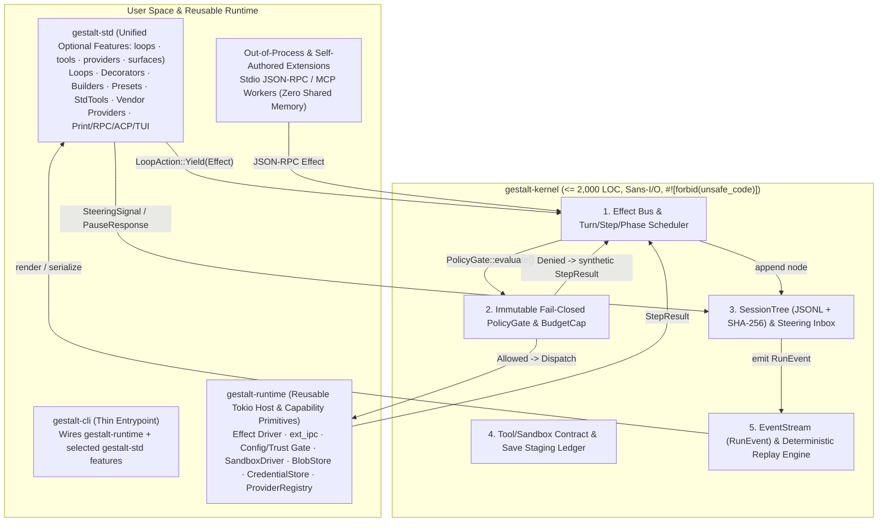

# Product Requirements Document (PRD): Gestalt v2

- **Product:** Gestalt — A Microkernel Agent Harness for Dynamic Semantics
- **Status:** Draft v1.0 (Aligned with `v2` Rust Rewrite)
- **Source Architecture:** [docs/ARCHITECTURE.md](file:///home/woshi/Code/Noentic/gestalt/gestalt-harness/docs/ARCHITECTURE.md)
- **Target Language & Stack:** Rust (Workspace, Minimal Dependencies, Sans-I/O Kernel)
- **Target Release:** `v0.1` Proof Gate MVP → `v0.2` → `v1.0`

---

## 1. Executive Summary

### Problem Statement
Open-source AI agent harnesses are trapped between two architectural failure modes: hard-coded generative LLM loops (`messages[] -> LLM -> tools -> repeat`) that cannot natively integrate non-generative models (such as fast System One classifiers like Jev) or custom control flows, and unbounded "everything-is-a-plugin" runtimes that externalize the root of trust (making security and sandboxing optional plugins) while creating combinatorial configuration complexity. Furthermore, existing TypeScript/Python runtimes carry heavy dependency trees, high startup latency, and weak compile-time isolation boundaries.

### Proposed Solution
**Gestalt** is an open-source, terminal-native agent harness written in **Rust with minimal dependencies**, built around a **≤ 2,000-line, sans-I/O invariant microkernel (`gestalt-kernel`)**, a **reusable capability & I/O runtime (`gestalt-runtime`)**, and a **unified, optional standard crate (`gestalt-std`)** wired by a thin binary (`gestalt-cli`). The kernel enforces five non-negotiable invariants (`SessionTree`, typed `Effect` bus, fail-closed `PolicyGate`, `Sandbox` boundary, and `EventStream` with deterministic replay), while all agent loops, context builders, model paradigms, tools, triggers, and UI surfaces run in user space through a single unified `Extension` contract—combining compile-time Rust traits for zero-overhead in-process extensions with out-of-process stdio JSON-RPC / MCP for dynamic, memory-isolated, self-authored extensions.

### Success Criteria
1. **Kernel Minimalism & Auditability:** `gestalt-kernel` remains **≤ 2,000 non-blank, non-comment LOC** (`tokei` / `cloc` verified), enforces `#![forbid(unsafe_code)]`, and has **≤ 2 direct crate dependencies** (`serde`, `serde_json`; zero async runtime, zero HTTP, zero OS-specific deps).
2. **Multi-Paradigm Dynamic Semantics:** Distinct user-space loops (`ChatLoop`, `DecisionRouter`) and composable presets/decorators (`swe`, `general`, `minimal_shell`, `goal_check`, `compaction`, `curator`) execute unmodified on the same `gestalt-kernel` binary and support mid-session switching via `/mode` or `Effect::Switch` with **100% session history preservation**.
3. **Fail-Closed Security & Sandbox Integrity:** **100% (0 bypasses)** of policy-violation test cases (disallowed tools, exceeded token/step/cost budgets, classifier timeout/error, and shell attempts to write to `protected_paths`) are blocked by `PolicyGate` and the native OS sandbox (`bubblewrap` on Linux, `Seatbelt` on macOS).
4. **Deterministic Offline Replay:** Any recorded multi-Phase `SessionTree` JSONL file replays offline with **0 network calls** and **100% bit-identical `Effect` sequence equivalence** against the recorded trace.
5. **Runtime Efficiency & Startup Performance:** Cold CLI startup (`gestalt --version` / headless `-p` boot before first API call) completes in **≤ 25 ms** with a single statically linked/self-contained release binary (**≤ 15 MB** stripped) and **≤ 30 MB** idle RSS.

---

## 2. User Experience & Functionality

### User Personas
1. **Systems / Harness Engineer ("Builder"):** Builds custom agent loops, multi-model routers (e.g., System One + LLM), or domain-specific context builders in Rust (compile-time `Extension` crates) or any language (out-of-process JSON-RPC/MCP extensions) without forking the harness.
2. **Terminal-Native Developer ("Operator"):** Uses `gestalt` daily in the terminal (TUI or `-p`/`--json` CLI) for software engineering (`swe` preset) and general tasks (`general` preset), relying on streaming output, reasoning visibility, mid-run steering, `/fork`, `/rewind`, and `/mode` switching.
3. **IDE / Automation Integrator ("Host"):** Embeds Gestalt headlessly via stdio JSON-RPC (`--mode rpc`) or Agent Client Protocol v1 (`--mode acp`) inside an editor, CI pipeline, or desktop/web GUI host.
4. **Security / Platform Engineer ("Reviewer"):** Audits `gestalt-kernel` in a single sitting (≤ 2,000 LOC) to verify fail-closed policy enforcement, budget ceilings, secret isolation, and OS-level sandboxing before approving production or autonomous loop usage.

### User Stories & Acceptance Criteria

#### US-1: Interactive Multi-Turn Coding & Chat (`ChatLoop` Default Preset)
> **As an** Operator, **I want to** chat with an agent that streams text and reasoning, executes workspace tools (`read`, `write`, `edit`, `glob`, `grep`, `bash`), and branches sessions cleanly, **so that** I have a productive terminal-native harness out of the box.

**Acceptance Criteria:**
- Interactive TUI streams assistant text deltas (`RunEvent::StreamDelta { channel: "text", .. }`) and normalized reasoning chunks (`RunEvent::StreamDelta { channel: "thought", .. }`) with a toggle to show/hide reasoning.
- Core tools `read` (line-ranged), `write`, `edit` (targeted replacement with inline diff preview), `glob`, `grep`, and `bash` (with explicit `cwd` and bounded background task handles) execute through `PolicyGate` and the active OS sandbox, registered via `StdToolsExtension` (never bolted into the kernel).
- Every Turn, Step, Effect, and StepResult is persisted atomically to an append-only, content-addressed JSONL `SessionTree` file.
- `/fork` creates a new branch from any historical `SessionTree` node without mutating prior nodes; `/rewind` moves the active head to a prior node.
- Non-interactive mode (`gestalt -p "<prompt>" --json`) runs a Turn to completion and emits newline-delimited JSON `RunEvent`s to stdout with exit code `0` on success and non-zero on error/abort.

#### US-2: Mid-Run Steering & Clean Interruption
> **As an** Operator, **I want to** redirect or cancel an in-flight agent run without corrupting conversation history or waiting for an entire multi-step Turn to finish, **so that** I stay in control of long-running tasks.

**Acceptance Criteria:**
- Sending `/steer <instruction>` while tools are running enqueues a `SteeringSignal::Steer` in the `SessionTree` Inbox; `ChatLoop` drains it after the current tool batch finishes and injects it into the next Step's `ContextBuilder`.
- Pressing `Ctrl+C`, running `/stop`, or receiving ACP `session/cancel` during an in-flight model stream or shell command cancels active I/O within **≤ 250 ms**, marks the node `interrupted`, and synthesizes `{ status: "aborted" }` `StepResult`s for any unpaired `tool_call` so subsequent LLM requests never fail with orphan tool-call errors.
- Sending a prompt while a Turn is active can be queued as `SteeringSignal::FollowUp`, automatically starting the next Turn once the current Turn completes cleanly.

#### US-3: Dynamic Model Paradigms, Composable Decorators & Mid-Session Mode Switching
> **As a** Builder or Operator, **I want to** combine fast non-generative decision models with generative LLMs, compose loop decorators (`/goal`, `compaction`), and switch between distinct presets (`swe`, `general`, `minimal_shell`) inside the same session, **so that** simple triage runs in ~90 ms without waking an LLM and task strategies adapt cleanly.

**Acceptance Criteria:**
- `DecisionRouter` invokes a `ModelKind::Decision` adapter (e.g., Jev) via `Effect::Model` without constructing chat `messages[]`; if confidence meets threshold (e.g., `>= 0.85`), it executes a deterministic `Effect::Tool` directly; otherwise it yields `Effect::Switch` to escalate to `ChatLoop` (or any configured fallback preset).
- Executing `/mode <preset>` or `Effect::Switch` seals the current `Phase` on the `SessionTree` (recording `{ phase_id, preset_id, base_loop_id, loop_digest, decorator_digests, builder_id, builder_digest, config }`) and opens a new `Phase` preserving full session history.
- Presets dynamically compose `Preset { base_loop, decorators, builder, config }`: `minimal_shell` composes `ChatLoop` + `SlidingWindowBuilder` + `["bash"]`, and the `goal_check` decorator wraps *any* active `AgentLoop` with deterministic exit criteria or evaluator checks until pass or `BudgetCap` exhaustion.

#### US-4: Cache-Stable Context Building & Lossless Compaction
> **As an** Operator working on long sessions, **I want** prompt assembly to preserve provider prefix caching and compact older history automatically without deleting underlying logs, **so that** token costs stay predictable and full audit history remains intact.

**Acceptance Criteria:**
- `StandardBuilder` assembles prompts in 3 cache-stable tiers (`stable` system/tool rules → `context` workspace files → `volatile` skills/memory) and places per-turn steering/recall notes in ephemeral user-turn slots.
- When estimated context usage crosses the decorator's `compaction_threshold` (configured in `LoopConfig::params`), the composable `compaction` `LoopDecorator` summarizes older `SessionTree` slices into a namespaced `"std:compaction"` node without deleting prior nodes or requiring a separate monolithic loop.

#### US-5: Unified Extension Surface (In-Process Rust + Out-of-Process JSON-RPC / MCP)
> **As a** Builder, **I want to** add custom loops, presets, triggers, context builders, model providers, tools, policy rules, slash commands, and UI renderers without modifying any `gestalt-*` core crate, **so that** customizations remain clean, composable, and upgrade-safe.

**Acceptance Criteria:**
- `gestalt-std` itself is registered via the exact same `Extension` Rust trait as external Rust extension crates (zero private kernel backdoors).
- An external compile-time Rust extension crate can register a custom `AgentLoop`, preset, `ContextBuilder`, `Tool`, and `UISurface` spec and override named slots without editing `gestalt-kernel` or `gestalt-std`.
- An external out-of-process extension (any language) is referenced in `gestalt.toml` (`[extensions.<name>]` with `command` and `protocol = "rpc" | "mcp"`) or passed ad-hoc via `--ext <cmd>`. Its actual slots (`loops`, `presets`, `builders`, `tools`, `commands`, `policies`, `ui`) are discovered dynamically via the `extension/describe` handshake (or `tools/list` for MCP) without duplicating slot definitions in TOML.
- Global extensions (`~/.config/gestalt/gestalt.toml`) load for all sessions; Workspace extensions (`<workspace>/.gestalt/gestalt.toml`) load only for that repository, merge/override user-space slots (`gestalt-std` < Global < Workspace), and require explicit workspace trust approval before spawning untrusted executables.
- Out-of-process extensions run in a separate OS process with zero shared memory with `gestalt-kernel`, and support **between-Turn/Phase hot-reload** (`/reload <ext>` restarting the worker process) without restarting `gestalt` or losing `SessionTree` state.
- Extensions may add stricter `PolicyRule`s, but attempting to relax kernel baseline rules, `BudgetCap`s, or `Sandbox` restrictions (including workspace overrides of global rules) is rejected at registration/evaluation time.

#### US-6: Fail-Closed PolicyGate, OS Sandboxing & Staged Self-Modification
> **As a** Security Reviewer, **I want** every side-effecting action to pass through an immutable fail-closed policy gate and OS sandbox, and any agent-authored changes to skills/memory to be staged and replay-verified before promotion, **so that** compromised prompts or buggy tools cannot exfiltrate secrets or tamper with harness controls.

**Acceptance Criteria:**
- Every `Model`, `Tool`, `Save`, and `Spawn` Effect is evaluated by `PolicyGate::evaluate()` before dispatch. If a rule, budget check, or mandatory classifier returns an error or times out, `PolicyGate` fails closed and returns `StepResult::Denied { reason }`.
- On Linux, `bash` and filesystem-mutating tools execute inside a `bubblewrap` (`bwrap`) sandbox; on macOS, inside a `sandbox-exec` (Seatbelt) profile. Configured `protected_paths` (e.g., `memories/`, `skills/` registered by `gestalt-std`) are mounted **read-only** inside the sandbox so shell commands cannot bypass `Effect::Save`.
- Host credentials stored in `CredentialStore` are never injected into sandboxed tool environments.
- `Effect::Save { mode: SaveMode::Stage, .. }` writes changes to an isolated staging area with SHA-256 content digests; `SaveMode::Promote` requires `PolicyGate` approval (and optional replay verification via the `curator` decorator).

#### US-7: Headless JSON-RPC, ACP v1 & Deterministic Offline Replay
> **As an** Integrator, **I want** protocol-neutral streaming over stdio JSON-RPC and ACP v1 plus deterministic offline replay of any session file, **so that** editors and CI systems can drive Gestalt reliably and engineers can debug failures without API spend.

**Acceptance Criteria:**
- `gestalt --mode rpc` exposes newline-delimited JSON-RPC over stdin/stdout for starting Turns, streaming `EventStream` `RunEvent`s, sending `SteeringSignal`s, switching modes, and resolving `Effect::Pause` dialogs.
- `gestalt --mode acp` implements Agent Client Protocol v1 (`session/prompt`, `session/cancel`, `session/update` including `agent_thought_chunk`, and `session/request_permission` mapped from `Effect::Pause`).
- `gestalt replay <session.jsonl>` re-executes recorded in-process `AgentLoop`s against logged `StepResult`s, blob-snapshotted `ArtifactStoreView`, and deterministic `ctx.now_ms()` with **0 network sockets opened**, verifying `Effect` sequence parity and reporting any divergence with node IDs (with `--reexecute-ext` available to re-run external workers inside `--unshare-net` sandboxes).

### Non-Goals (`v0.1` & Architectural Omissions)
To protect the `v0.1` Proof Gate timeline and prevent architectural bloat, Gestalt explicitly will **NOT** build:
1. **No declarative YAML/JSON control-flow DSL in the kernel:** Loops, retries, and branching live in typed Rust `AgentLoop` code (or out-of-process worker code), never in a kernel state-machine DSL.
2. **No global proxy DI container (Cordis-style) or hot-swappable kernel:** `gestalt-kernel` (`SessionTree`, `Effect` bus, `PolicyGate`, `Sandbox` contract) is fixed at boot.
3. **No embedded scripting VM (`Rhai`, `Lua`, `QuickJS`, `Boa`, `Wasmtime`) in `v0.1`:** Keeps the binary small, dependency tree minimal, and security surface auditable; dynamic extensions use out-of-process stdio JSON-RPC / MCP.
4. **No kernel-level memory ontology or vector database:** The kernel stores `SessionTree` nodes and content-addressed blobs; memory formats (`MEMORY.md`, `SKILL.md`) and compaction prompts belong solely in user space.
5. **No fake "reversible external action" promise:** Unloading an extension cannot undo external side effects; safety relies strictly on pre-execution `PolicyGate` checks, `SideEffectClass`, and OS sandboxes.
6. **Deferred to `v0.2+`:** Docker / Firecracker micro-VM sandbox drivers, standalone Desktop/Web GUI host (Tauri/Electron/WebSocket), cloud cron `/schedule` triggers, and MCP Code Mode sandboxed JS execution.

---

## 3. AI System Requirements

### Model Paradigms & Provider Adapters (`gestalt-runtime` + `gestalt-std/providers`)
Every `Effect::Model` explicitly declares a `ModelKind` so non-generative models are first-class citizens rather than bolted-on tools:

| `ModelKind` | Purpose | `v0.1` Implementation |
| :--- | :--- | :--- |
| `Llm` | Generative text, streaming reasoning (`thought` blocks), and structured tool calls | Anthropic Messages API (SSE streaming + prompt caching breakpoints) & OpenAI Responses/Chat Completions API (SSE streaming) |
| `Decision` | Fast (~90 ms) typed System One classification, routing, and safety gating | Jev adapter (`decision` HTTP/JSON API returning typed choice + calibrated confidence score) |
| `Embedding` | Vector representations for user-space retrieval | Trait/wire type defined in `gestalt-kernel`; provider adapter optional / `v0.2` |
| `WorldModel` | Action simulation prior to tool execution | Trait/wire type defined in `gestalt-kernel`; provider adapter `v0.2+` |
| `ComputerUse` | GUI/screen action prediction | Trait/wire type defined in `gestalt-kernel`; provider adapter `v0.2+` |

- `gestalt-runtime` provides the `ModelProvider` trait, `ProviderRegistry`, SSE line parser, and host-side `CredentialStore`; concrete vendor adapters (`anthropic`, `openai`, `jev`) live in `gestalt-std` (behind the `providers` Cargo feature) or external extensions and normalize wire quirks into user-space typed payloads (`LlmOutput`, `DecisionOutput`) inside the kernel's paradigm-agnostic `StepResult::Model { kind, output, usage }`.
- **Multimodal & Blob References:** `ModelInput` content blocks natively support text and `{ kind: "media", mime_type, blob_digest }` pointers backed by the content-addressed blob store (`.gestalt/blobs/<sha256>`), keeping large binary assets out of inline JSONL nodes.

### Tool Requirements (`gestalt-runtime` + `gestalt-std/tools`)
All tools declare an explicit `SideEffectClass` (`Read`, `Idempotent`, `Irreversible`) and a JSON schema for arguments:
- **Core Built-in Tools (`v0.1`, 8 registered tools in `StdToolsExtension`; in-process file tools guarded by `WorkspacePathGuard`):**
  1. `read` (`Read`): Line-ranged file reading with byte/line truncation guards; workspace-scoped.
  2. `write` (`Idempotent` / `Irreversible` on overwrite, elevated dynamically by `WorkspacePathGuard`): File creation/replacement inside sandboxed workspace.
  3. `edit` (`Idempotent`): Exact-match targeted diff replacement returning structured diff metadata for `UISurface`.
  4. `glob` (`Read`): Fast workspace path matching (`.gitignore`-aware) without spawning a `bash` sandbox subprocess.
  5. `grep` (`Read`): Line-numbered literal/regex content search across workspace files without spawning a `bash` sandbox subprocess.
  6. `bash` (`Irreversible` by default, configurable per command policy): Sandboxed subprocess execution with explicit optional `cwd` (tracked in tool metadata for deterministic replay), configurable timeout, stdout/stderr spill-to-blob, abort-signal process-group termination, and bounded background task handles (`background: true` returning a `task_id` scoped to the active Turn by default, inspectable via `bash_output` / terminable via `bash_kill`, and automatically reaped when the scope ends).
  7. `bash_output` (`Read`): Inspects buffered stdout/stderr of a running or completed background `bash` task by `task_id`.
  8. `bash_kill` (`Irreversible`): Terminates a background `bash` task process group by `task_id`.
- **Large Output Spill-to-Blob:** Tool outputs exceeding an inline threshold (default `32 KB`) store a truncated head/tail preview inline in `StepResult` alongside a `blob_digest: Sha256` pointer in `.gestalt/blobs/<sha256>`, inspectable on demand via `read` without bloating `SessionTree` JSONL or `ContextBuilder` budgets.
- **MCP Bridge (`v0.1` optional feature):** `McpToolProvider` connects to stdio MCP servers and exposes discovered tools through the exact same `Tool` + `PolicyGate` + `SideEffectClass` pipeline (defaulting unknown MCP tools to `Irreversible` unless explicitly policy-classified).

### Context Engineering & Memory (`gestalt-std`)
- **Pure Projection:** `ContextBuilder::build(&SessionSlice, &ArtifactStoreView, &ModelCapabilities) -> ModelInput` is a pure function with zero hidden global state.
- **3-Tier Cache-Stable Prompt Assembly (`StandardBuilder`):**
  - *Tier 1 (Stable):* System instructions and tool schemas (prefix-cache pinned).
  - *Tier 2 (Context):* Repository/workspace files and `AGENTS.md` / project conventions.
  - *Tier 3 (Volatile):* Active `SKILL.md` disclosures and bounded `MEMORY.md` / `USER.md` artifacts.
  - *Ephemeral Slot:* Mid-run `SteeringSignal`s and per-step recall notes appended to the latest user turn to avoid invalidating Tier 1–2 provider caches.
- **Compaction (`compaction` Decorator):** A composable `LoopDecorator` that checks token usage against `LoopConfig::params["compaction_threshold"]` and summarizes older `SessionTree` slices into a namespaced `"std:compaction"` node without deleting historical nodes.

### Evaluation & Verification Strategy
Because Gestalt is an agent harness rather than a single model, evaluation targets **runtime correctness, safety invariants, loop behavior, and replay determinism**:

1. **Deterministic Replay Suite (CI-Gated, 0 Network Calls):**
   - Maintain ≥ 10 golden `SessionTree` JSONL fixtures covering: multi-turn chat + tool calling, mid-step `abort` with pending tool calls, intra-turn `steer`, `DecisionRouter` fast-path vs. LLM escalation, `goal_check` retry-until-pass, `compaction` summarization, and `spawn` parallel subagents.
   - **Pass Criteria:** 100% of fixtures replay offline with zero network I/O and 100% identical `Effect` logs.
2. **Fail-Closed Security & Sandbox Conformance Suite (CI-Gated):**
   - Automated adversarial tests attempting: (a) disallowed tool invocation, (b) `BudgetCap` overflow (tokens, steps, cost), (c) simulated classifier timeout/500 error (must deny, never allow), (d) `bash` command writing to any `protected_paths` entry (must fail via OS read-only bind mount), (e) `bash` reading host `CredentialStore` env/files (must fail), (f) extension attempting to weaken kernel policy (must be rejected).
   - **Pass Criteria:** 100% block rate (0 false allows).
3. **System One Triage & Loop Quality Benchmark (Pre-Release):**
   - Run `DecisionRouter` against a 50-task synthetic triage dataset (25 deterministic quick-fix tasks + 25 complex multi-file tasks) using live or recorded decision-model + LLM responses.
   - **Pass Criteria:** ≥ 85% routing accuracy (fast-path vs. escalation), median System One triage latency ≤ 150 ms (excluding network RTT variance), and ≥ 30% token cost reduction compared to unconditional LLM execution on the same suite.
4. **ACP v1 & JSON-RPC Protocol Conformance:**
   - Automated harness tests verifying `session/prompt`, `session/cancel`, `session/update`, and `session/request_permission` round-trips against the ACP v1 schema.

---

## 4. Technical Specifications

### Architecture Overview: Sans-I/O Rust Microkernel vs. User Space

Unlike the TypeScript spec's `AsyncGenerator` runtime, Rust achieves zero-overhead, dependency-free resumable loops using a **Sans-I/O state-machine kernel (`gestalt-kernel`)**. `gestalt-kernel` performs **no network I/O, no subprocess spawning, and no async runtime scheduling**; it owns state transitions, `SessionTree` node construction/hashing, `PolicyGate` evaluation, `Steering` inbox management, and `EventStream` emission. `gestalt-runtime` drives the I/O loop (async via `tokio`) by polling the kernel for the next approved `Effect`, executing it via registered providers, sandboxed tools, or out-of-process extensions, and feeding the `StepResult` back into the kernel.

- **Transient Stream Events vs. Canonical Kernel Events:** While an `Effect` is in flight, the I/O driver emits **transient stream events** (`RunEvent::StreamDelta { channel, payload }`, tagged with `(turn_id, phase_id, effect_id)`—where `gestalt-std` uses channels `"text"`, `"thought"`, `"tool_output"`) directly onto the `EventStream` channel for responsive TUI/RPC/ACP streaming. Only **canonical kernel events** (`NodeAppended`, `PhaseSwitched`, `PolicyDenied`, `Paused`, and final assembled `StepResult`s) are persisted to the `SessionTree` JSONL, preventing single-token log bloat.



### Turn, Step, Phase & Steering Execution Semantics
1. **Turn:** One user-facing cycle (`TurnId`) spanning 1..N Steps and 1..M Phases.
2. **Step:** One atomic unit of progress (typically one `Effect::Model` + its resulting `Effect::Tool` batch).
3. **Phase:** Bounded mode governed by one active `AgentLoop`, `ContextBuilder`, and `LoopConfig`. Changing modes requires `Effect::Switch` (or `/mode`), which seals the current Phase with `{ loop_id, loop_digest, builder_digest, config }`.
4. **Three Steering Modes:**
   - **Between-Step (`Steer`):** Enqueued in `SessionTree` Inbox; drained via `ctx.drain_steering()` after the current tool batch finishes so every `tool_call` has a paired `tool_result`.
   - **Mid-Step (`Abort` / Urgent `Steer`):** Cancels in-flight I/O via `CancellationToken` (in the I/O driver), marks active node `interrupted`, and synthesizes `StepResult::Aborted` for any unpaired `tool_call`.
   - **Between-Turn (`FollowUp`):** Queued until the active Turn completes, then initiates Turn N+1.

### Rust Workspace & Minimal Dependency Budget

To avoid the dependency sprawl observed in `v1`, `v2` enforces a strict workspace crate layout and dependency ceiling:

| Crate | Role | LOC / Safety Budget | Allowed Direct Dependencies (Minimal) |
| :--- | :--- | :--- | :--- |
| **`gestalt-kernel`** | Invariant sans-I/O microkernel (`SessionTree`, `Effect` bus, `PolicyGate`, `EventStream`, replay, `Extension` traits) | **≤ 2,000 LOC**, `#![forbid(unsafe_code)]` | `serde`, `serde_json` (max 2 crates; SHA-256 implemented in ~80 lines of pure safe Rust to keep deps ≤ 2) |
| **`gestalt-runtime`** | Reusable Tokio I/O host & capability primitives: `Effect` driver, `ext_ipc` (stdio JSON-RPC + MCP bridge), `config`/trust gate, `SandboxDriver` (`bubblewrap` / `Seatbelt`), `BlobStore`, `CredentialStore`, `ProviderRegistry` + SSE parser | Zero hardcoded loops, tools, vendors, or UI | `gestalt-kernel`, `serde`, `serde_json`, `tokio`, `reqwest` (with `rustls-tls`, `stream`; no OpenSSL; no `libc`, `similar`, `encoding_rs`, or `glob`) |
| **`gestalt-std`** | Unified optional batteries-included crate (Cargo features: `loops`, `tools`, `providers`, `surfaces`): standard loops/decorators/builders/presets, `StdToolsExtension`, vendor provider adapters (`anthropic`, `openai`, `jev`), and default surfaces (`print`, `rpc`, `acp`, `tui`) | Dogfoods `Extension` & `UISurface` traits | `gestalt-kernel`, `gestalt-runtime`, `serde`, `serde_json`, `tokio`, `regex-lite`/`ignore`/`similar` (**behind `#[cfg(feature = "tools")]`**), `ratatui` + `crossterm` (**behind `#[cfg(feature = "tui")]`**) |
| **`gestalt-cli`** | Thin binary entrypoint (`gestalt`): parses CLI flags via minimal parser and wires `gestalt-runtime` + selected `gestalt-std` features (or user extensions/surfaces) | Thin composition root | `gestalt-kernel`, `gestalt-runtime`, `gestalt-std`, `tokio`, `anyhow` |

- **Rust Toolchain & Lints:** Rust Edition 2024 (or 2021, MSRV 1.85+), `#![forbid(unsafe_code)]` workspace-wide, `clippy::all = "deny"`, release profile `lto = true`, `strip = true`, `codegen-units = 1`.

### Primitives vs. Composable Features (The Linux Kernel Philosophy)

Following the **Linux kernel philosophy**, Gestalt ships a bare-bones kernel (`gestalt-kernel`) and bare-minimum host drivers (`gestalt-runtime`) as the actual core program, paired with built-in default userland features (`gestalt-std` + `gestalt-cli`) in the same repository so Gestalt boots out of the box as an immediately usable product that can then extend and improve itself in user space:

| Category | Where It Lives | What It Includes | Optional / Replaceable? |
| :--- | :--- | :--- | :--- |
| **Kernel Primitives** | `gestalt-kernel` | `SessionTree` (with namespaced user-space node kinds) + `Steering` Inbox, typed `Effect` bus & Turn/Step/Phase scheduler, fail-closed `PolicyGate`, `Sandbox` (`protected_paths`) & `Save` boundary, `EventStream` (`StreamDelta`) & replay engine, and extension trait contracts (`AgentLoop`, `AgentLoopFactory`, `LoopDecorator`, `ContextBuilder`, `Extension`, `UISurface`). | **No.** Fixed at boot; zero knowledge of LLMs, prompts, chat `messages[]`, `SKILL.md`, `MEMORY.md`, or specific tools. |
| **Runtime Primitives** | `gestalt-runtime` | Reusable Tokio `Effect` driver, `ext_ipc` (out-of-process JSON-RPC + MCP), `gestalt.toml` loader & trust gate, `SandboxDriver` (`bwrap` / `Seatbelt`), `BlobStore`, `CredentialStore`, `ModelProvider` registry. | **Host-level.** Reusable by any custom binary or surface with zero `gestalt-std` assumptions. |
| **Composable Features & Surfaces** | `gestalt-std` (Cargo-feature gated) & external extensions | Optional default loops (`ChatLoop`, `DecisionRouter`), composable `LoopDecorator`s (`goal_check`, `compaction`, `curator`), presets (`swe`, `general`, `minimal_shell`), builders (`StandardBuilder`, `DecisionStateBuilder`, `SlidingWindowBuilder`), `SKILL.md` / `MEMORY.md` protected paths, vendor provider adapters (`anthropic`, `openai`, `jev`), `StdToolsExtension`, domain commands (`/goal`, `/compact`), and standard surfaces (`print`, `rpc`, `acp`, `tui`). | **Yes.** `gestalt-std` has zero private kernel/runtime backdoors and registers via the exact same `Extension`, `ProviderRegistry`, and `EventStream` contracts as external or agent-authored code. |

**Enforced Architectural Standards (Kernel Purity & Generalized Naming):**
1. **No Bolted-In Semantics in `gestalt-kernel` or `gestalt-runtime`:** Any concept tied to chat loops, markdown files (`SKILL.md`, `MEMORY.md`), specific tools (`bash`), or specific model output shapes (`reasoning`, `tool_calls`) MUST live in `gestalt-std` or external extensions, never in `gestalt-kernel` or `gestalt-runtime`. Kernel types use generic extension points (`LoopConfig::params`, `StepResult::Model { output: Value }`, `RunEvent::StreamDelta { channel, payload }`, `Sandbox::protected_paths`, namespaced `SessionTree` node kinds).
2. **Composable Loop Variations:** Adding a new loop type implements `AgentLoopFactory`; cross-cutting behaviors (`goal_check`, `compaction`, `curator`) are `LoopDecorator`s composed dynamically via `Preset { base_loop, decorators, builder, config }`. `ChatLoop` is simply the default option if a user does not supply their own.
3. **Generalized Naming (No Third-Party Product Names in Code/Presets):** Code identifiers, loop IDs, builder names, and presets MUST use generalized, vendor-neutral names (`swe`, `general`, `minimal_shell`, `chat`, `decision_router`, `DecisionStateBuilder`). External product names appear *only* as concrete provider adapter modules inside `gestalt-std/src/extensions/providers/` (e.g., `anthropic`, `openai`, `jev`).
4. **Kernel-Backed vs. Extension Commands:** `gestalt-cli` / `gestalt-runtime` own only kernel-backed session/steering commands (`/mode`, `/steer`, `/stop`, `/fork`, `/rewind`, `/reload`); domain commands (`/goal`, `/compact`, `/gate`, `/login`) register via `Extension`.

**Building a Custom Agent & Self-Extending at Runtime:**
1. **Zero-`std` Custom Harness (Rust):** A builder can depend on `gestalt-kernel` + `gestalt-runtime` (omitting `gestalt-std` entirely), implement custom `AgentLoop`, `ContextBuilder`, `Extension`, and surfaces from scratch (e.g., a domain-specific `WorldModel -> Decision -> Tool` loop with no chat history or markdown skills), and still inherit `SessionTree`, `PolicyGate`, `Sandbox`, `BlobStore`, and deterministic offline replay.
2. **Coexist or Override:** Keep `gestalt-std` loaded (or enable only specific Cargo features like `tools` + `providers`) and register custom loops/builders/surfaces alongside it, or override any named slot (`loops`, `presets`, `builders`, `tools`, `ui`) via `ExtensionRegistry`.
3. **Self-Extension Without Recompiling Core Crates:** When prompted to add new capabilities, an agent running inside Gestalt can author a new out-of-process extension (custom `AgentLoop`, `LoopDecorator`, `Tool`, `PolicyRule`, or `UISurface` spec in `.gestalt/extensions/<name>/`) or new `skills/` artifacts via `Effect::Save`, register it in `<workspace>/.gestalt/gestalt.toml` (gated by `PolicyGate` and explicit workspace trust approval), and activate it live via `/reload <ext>` with zero loss of `SessionTree` history. Custom external surfaces can likewise connect over `--mode rpc` / `--mode acp` or consume `gestalt-runtime`'s `EventStream` + `UISurface` directly.

### Core Kernel Interfaces (Rust Mapping)

Translating the architecture spec's TypeScript types into idiomatic, sans-I/O Rust:

```rust
pub enum ModelKind {
    Llm,
    Decision,
    Embedding,
    WorldModel,
    ComputerUse,
}

pub enum SideEffectClass {
    Read,
    Idempotent,
    Irreversible,
}

pub enum SaveMode {
    Stage,
    Promote,
}

pub enum PauseReason {
    Approval,
    Input,
    Checkpoint,
}

pub enum WorkspaceMode {
    /// Child subagent can read workspace files but cannot mutate files
    ReadOnly,
    /// Child subagent shares the workspace (only valid for non-concurrent single spawns)
    Shared,
    /// Child subagent runs in an isolated git worktree or temp workspace copy
    Worktree,
}

pub enum PolicyDecision {
    Allow,
    Deny { reason: String },
    /// Sans-I/O deferral: driver executes `verifier_effect` (e.g., Jev classifier) first;
    /// kernel logs its StepResult for replay and fails closed to Deny on error/timeout.
    RequiresVerification {
        verifier_effect: Box<Effect>,
        pending_effect: Box<Effect>,
    },
}

pub enum Effect {
    Model {
        target: String,
        kind: ModelKind,
        input: serde_json::Value,
        schema: Option<serde_json::Value>,
    },
    Tool {
        name: String,
        args: serde_json::Value,
        side_effect: SideEffectClass,
    },
    Save {
        artifact: String,
        patch: ArtifactPatch,
        mode: SaveMode,
    },
    Spawn {
        loop_id: String,
        input: serde_json::Value,
        budget: BudgetCap,
        depth_limit: u8,
        workspace_mode: WorkspaceMode,
        config: Option<LoopConfig>,
    },
    Switch {
        next_loop: String,
        handoff: serde_json::Value,
        config: Option<LoopConfig>,
    },
    Pause {
        reason: PauseReason,
        payload: serde_json::Value,
    },
}

/// Resumable state-machine equivalent of TS AsyncGenerator<Effect | Effect[], Result, StepResult>
pub enum LoopAction {
    /// Yield one effect or a parallel batch (e.g., parallel tool calls or parallel spawn)
    Yield(Vec<Effect>),
    /// Complete the current Phase/Turn with a typed output
    Done(serde_json::Value),
}

pub trait AgentLoop: Send {
    fn id(&self) -> &str;
    /// Deterministic version/source digest recorded on Phase open for replay safety
    fn digest(&self) -> &str;
    /// Advance the loop given the kernel-owned LoopContext and optional prior StepResults
    fn step(&mut self, ctx: &mut dyn LoopContext, results: Option<Vec<StepResult>>) -> LoopAction;
}

/// Kernel-level LoopConfig holds ONLY kernel-enforced bounds plus an opaque user-space `params` bag.
/// Chat/std concepts (model ID, compaction threshold, skills flags) live inside `params`.
pub struct LoopConfig {
    pub allowed_tools: Option<Vec<String>>,
    pub max_spawn_depth: Option<u8>,
    pub budget: Option<BudgetCap>,
    pub params: serde_json::Value,
}

/// Composable Preset: dynamically wires any base loop + ordered decorators + context builder.
pub struct Preset {
    pub base_loop: String,
    pub decorators: Vec<String>,
    pub builder: String,
    pub config: LoopConfig,
}

/// Factory registered in ExtensionRegistry so every Phase and Spawn gets a fresh instance.
pub trait AgentLoopFactory: Send + Sync {
    fn id(&self) -> &str;
    fn digest(&self) -> &str;
    fn create(&self, config: &LoopConfig, registry: &ExtensionRegistry) -> Box<dyn AgentLoop>;
}

/// Composable cross-cutting behavior (e.g., `goal_check`, `compaction`, `curator`)
/// that wraps ANY `AgentLoop` without requiring a separate loop implementation.
pub trait LoopDecorator: Send + Sync {
    fn id(&self) -> &str;
    fn digest(&self) -> &str;
    fn wrap(
        &self,
        inner: Box<dyn AgentLoop>,
        config: &LoopConfig,
        registry: &ExtensionRegistry,
    ) -> Box<dyn AgentLoop>;
}

pub trait ContextBuilder: Send + Sync {
    fn id(&self) -> &str;
    fn digest(&self) -> &str;
    fn build(
        &self,
        session: &SessionSlice,
        artifacts: &ArtifactStoreView,
        caps: &ModelCapabilities,
    ) -> serde_json::Value;
}

/// Unified Extension contract — implemented by gestalt-std and external Rust crates alike
pub trait Extension: Send + Sync {
    fn name(&self) -> &str;
    fn register(&self, registry: &mut ExtensionRegistry) -> Result<(), ExtensionError>;
}
```

### Integration Points
1. **Persistence (`SessionTree` JSONL, Blob Store & `Spawn` Linkage):**
   - Stored as append-only newline-delimited JSON files (e.g., `.gestalt/sessions/<session_id>.jsonl`), paired with a content-addressed blob store (`.gestalt/blobs/<sha256>`) for large tool outputs (`> 32 KB`) and multimodal media assets.
   - Node schema: `{ id, parent_id, turn_id, phase_id, timestamp_ms, kind, payload, digest }` where `digest` is `sha256(parent_id || kind || canonical_json(payload))`.
   - `Effect::Spawn` creates a child branch rooted at the parent's `spawn_node_id`, enforces `WorkspaceMode` (`ReadOnly` default for parallel spawns, `Worktree` for isolated parallel edits, or `Shared`), and logs `StepResult::SpawnCompleted { child_head_id, output, usage }` back onto the parent branch upon completion.
   - Language-agnostic wire format so external analyzers, GUI hosts, or replay tools can inspect sessions directly.
2. **Extension Registration, Global vs. Workspace Scoping & IPC (`gestalt.toml` / `--ext`):**
   - **Reference-Only Config:** Built-in/compile-time Rust extensions (`gestalt-std`, etc.) register directly in Rust via `ExtensionRegistry`. Dynamic out-of-process extensions are declared by reference in `gestalt.toml` (`[extensions.<name>]` with `command`, `protocol = "rpc" | "mcp"`, and optional policy constraints) or passed ad-hoc via `--ext <cmd>`.
   - **Two-Tier Scope & Merge Precedence:**
     - **Global (User):** `~/.config/gestalt/gestalt.toml` — loaded for all sessions and implicitly trusted by the user.
     - **Workspace (Project):** `<workspace>/.gestalt/gestalt.toml` — scoped to that repository only.
     - **Precedence:** Named user-space slots (`loops`, `presets`, `builders`, `tools`, `ui`) merge in order `gestalt-std` → Global → Workspace (later tiers override earlier slots by name). `PolicyGate` rules are strictly **monotonic** (`Kernel` ≤ `Global` ≤ `Workspace` in restrictiveness; workspace config can tighten rules/budgets, never relax them).
   - **Workspace Trust Gate:** Before spawning any `command` declared in a workspace-local `.gestalt/gestalt.toml`, `gestalt` checks a global trust allowlist keyed by `(workspace_path, config_sha256)`. Untrusted workspaces prompt for explicit approval (or require `--trust-workspace` in headless CI).
   - **Out-of-Process Protocol & Stateful `loop/step`:** Spawns external extension executables over stdio using newline-delimited JSON-RPC 2.0. Handshake (`extension/describe`) dynamically discovers provided `loops`, `presets`, `builders`, `tools`, `commands`, additive `policies`, and `ui` specs. When an external worker drives a custom `AgentLoop`, `loop/step` passes `{ phase_id, turn_id, handoff, config, state_token, results }` and receives `{ action, state_token }`—persisting `state_token` on the `SessionTree` for crash recovery and exact replay. Tools can also be mounted directly via standard stdio MCP (`tools/list`, `tools/call`). Supports **between-Turn/Phase hot-reload** via `/reload <ext>` or file-watcher worker restart without dropping the kernel or `SessionTree`.
3. **Host-Side Authentication (`CredentialStore`):**
   - Reads provider keys/tokens from environment variables or OS-protected host config files (with `0600` permissions) inside `gestalt-runtime`.
   - Never exposed to `AgentLoop` payloads, `SessionTree` logs (redacted before serialization), or sandboxed `Tool` subprocess environments.
4. **Protocol Adapters (`gestalt-std/surfaces`):**
   - **Stdio JSON-RPC (`--mode rpc`):** Exposes `turn/start`, `turn/steer`, `turn/cancel`, `phase/switch`, `pause/resolve`, and streams `event/notify` (`RunEvent`).
   - **ACP v1 (`--mode acp`):** Maps `session/prompt` → Turn start, `session/cancel` → preemptive `Abort`, `EventStream` → `session/update` (including `agent_thought_chunk`), and `Effect::Pause` → `session/request_permission`.
   - **`UISurface` Contract:** Tools and loops emit structured `RunEvent::ToolUi { renderer, data }` and `RunEvent::Pause { dialog, data }` payloads; TUI renders them natively while RPC/ACP clients forward them intact to GUI hosts.

### Security & Privacy
1. **Fail-Closed `PolicyGate`:** Evaluates every `Model`, `Tool`, `Save`, and `Spawn` before execution, returning `PolicyDecision` (`Allow`, `Deny`, or `RequiresVerification` for Sans-I/O external classifiers such as Jev). Checks: (a) monotonic `BudgetCap` (max steps, max tokens, max USD cost), (b) active Phase `allowed_tools` & `SideEffectClass` rules, (c) `spawn` `depth_limit` (default `1`, non-nesting subagents) and `WorkspaceMode`, and (d) mandatory classifiers/regex guards. Any error, panic-catch, or classifier timeout returns `StepResult::Denied`.
2. **Monotonic Policy Precedence:** Kernel baseline policies are immutable at boot. Extensions can register additional `PolicyRule`s that only narrow permissions or tighten budgets; any rule attempting to allow a kernel-denied effect is ignored/rejected.
3. **OS-Level Sandboxing:**
   - **Linux:** `bwrap` (`bubblewrap`) with unshared PID/IPC/UTS namespaces, workspace bind-mounted read-write, all configured `protected_paths` (e.g., `memories/` and `skills/` registered by `gestalt-std`) bind-mounted **read-only**, network isolated (`--unshare-net`) by default unless explicitly permitted by policy.
   - **macOS:** `sandbox-exec` with generated Seatbelt SBPL profile restricting filesystem writes strictly to the workspace (explicitly denying writes to `protected_paths`) and denying outbound network by default.
   - If the required OS sandbox binary is unavailable and the policy requires sandboxing, execution **fails closed** (refuses to run unsandboxed unless the operator explicitly passes `--unsafe-no-sandbox` with a visible warning logged to `SessionTree`).
4. **Secret Hygiene & Redaction:** API keys and auth headers are stripped from all `SessionTree` nodes, `EventStream` events, and sandboxed subprocess environments (`env_clear()` + explicit allowlisted vars).

---

## 5. Risks & Roadmap

### Phased Rollout

#### Phase 1: `v0.1` Proof Gate MVP (Target: Core Architecture & Verification)
- **Milestone 1.1 — Kernel & Replay (`gestalt-kernel`):** `SessionTree` JSONL + SHA-256 digests, `Effect` bus, Turn/Step/Phase state machine, `Steering` inbox + orphan tool-call synthesis, fail-closed `PolicyGate`, `EventStream`, deterministic `replay` engine (≤ 2,000 LOC, ≤ 2 deps).
- **Milestone 1.2 — Runtime Primitives (`gestalt-runtime`):** Tokio `Effect` driver, `ext_ipc` (stdio JSON-RPC + MCP bridge), `gestalt.toml` loader & workspace trust gate, host `CredentialStore`, `BlobStore` (`.gestalt/blobs/<sha256>`), `ProviderRegistry` + SSE parser, and Linux `bubblewrap` / macOS `Seatbelt` `SandboxDriver`s.
- **Milestone 1.3a — Standard Loops, Tools & Providers (`gestalt-std`):** Optional feature-gated crate (`loops`, `tools`, `providers`) shipping `ChatLoop`, `DecisionRouter`, `LoopDecorator`s (`goal_check`, `compaction`, `curator`), builders (`StandardBuilder`, `DecisionStateBuilder`, `SlidingWindowBuilder`), presets (`swe`, `general`, `minimal_shell`), `StdToolsExtension` (8 core tools), and vendor adapters (`anthropic`, `openai`, `jev`).
- **Milestone 1.3b — Standard Surfaces (`gestalt-std`):** Optional feature-gated surfaces (`print`, `rpc`, `acp`, `replay`, `tui`).
- **Milestone 1.4 — Thin CLI & Proof Gate (`gestalt-cli`):** Minimal binary wiring `gestalt-runtime` + `gestalt-std` features, self-extension `/reload` end-to-end verification, 50-task System One Triage benchmark, and passing all 5 `v0.1` Acceptance Gate checks.

#### Phase 2: `v0.2` Ecosystem, Triggers & Container Sandboxes
- **Milestone 2.1 — Container & Micro-VM Sandboxes:** Docker and micro-VM (`Firecracker` / Apple Virtualization) `SandboxDriver` implementations for untrusted/cloud workloads.
- **Milestone 2.2 — Event & Schedule `Trigger` Runtime:** Time-based and event-driven `Trigger`s (`/loop` local interval, webhook, file watcher, cloud `/schedule` hooks).
- **Milestone 2.3 — MCP Code Mode & Expanded Model Paradigms:** Optional MCP Code Mode sandbox adapter (`search`/`execute` meta-tools), `Embedding`, `WorldModel`, and `ComputerUse` provider adapters, and automated multi-trace `curator` regression replay gating before `SaveMode::Promote`.

#### Phase 3: `v1.0` Production Stability & Multi-Surface Platform
- **Milestone 3.1 — Schema v1 Freeze & Maintenance:** Stable `SessionTree` v1 schema (`schema_version: 1`), `gestalt-kernel` 1.0 API freeze with SemVer CI checks, and `gestalt gc` blob/staging cleanup.
- **Milestone 3.2 — Reference GUI Host & Proactive Workflows:** Reference Desktop/Web GUI host consuming `EventStream` and `UISurface` over WebSocket / ACP, plus multi-agent proactive workflows combining `Trigger` + `goal_check` + parallel `Effect::Spawn` worktrees with adversarial judge loops.

### Technical Risks & Mitigations

| Risk | Severity | Impact | Mitigation |
| :--- | :---: | :--- | :--- |
| **Rust State-Machine Ergonomics vs. TS Generators** | High | Writing `AgentLoop`s as manual `step()` state machines can feel verbose compared to TS `async function*`, discouraging adoption. | Provide clean composable Rust helpers (`ToolBatchRunner`, `with_compaction`, `with_goal_check`) in `gestalt-std` and support writing loops in any language (including TypeScript/Python) via the out-of-process stdio JSON-RPC `Extension` protocol. |
| **Kernel LOC & Dependency Creep** | Medium | Kernel exceeding 2,000 LOC or pulling in `tokio`/HTTP crates undermines auditability and the sans-I/O guarantee. | Enforce CI gates checking `gestalt-kernel` LOC (≤ 2,000), `cargo tree -p gestalt-kernel` (≤ 2 direct deps), and `#![forbid(unsafe_code)]`. |
| **OS Sandbox Portability & Environment Quirks** | High | `bubblewrap` may be blocked in unprivileged containers (user namespaces disabled); macOS `sandbox-exec` is deprecated by Apple and sensitive to profile syntax. | Fail closed by default; ship comprehensive integration tests on both Linux and macOS CI runners; design `SandboxDriver` trait cleanly so Docker/micro-VM drivers plug in cleanly in `v0.2`. |
| **Mid-Step Abort & Provider Stream Desync** | Medium | Cancelling an SSE stream mid-tool-call can leave broken JSON arguments or unpaired tool calls, causing 400 errors on the next LLM turn. | Kernel tracks issued `tool_call_id`s per Step and automatically synthesizes `StepResult::Aborted` for any unresolved call before accepting the next Step or Turn. |
| **Provider API & Prompt Caching Drift** | Medium | Anthropic/OpenAI/Jev API updates or subtle prompt ordering shifts can silently break prefix caching or reasoning extraction. | Isolate all provider wire formats inside `gestalt-std/src/extensions/providers/`; add unit tests asserting stable Tier 1–2 byte-prefix identity across multi-turn `StandardBuilder` projections. |
| **Out-of-Process Extension Latency / IPC Crashes** | Low | A crashing or slow `--ext` worker could stall a Turn. | Enforce per-call IPC timeouts in the I/O driver, treat extension crashes as `StepResult::Error` (or `PolicyGate` deny if acting as a classifier), and support clean worker respawn between Phases. |
